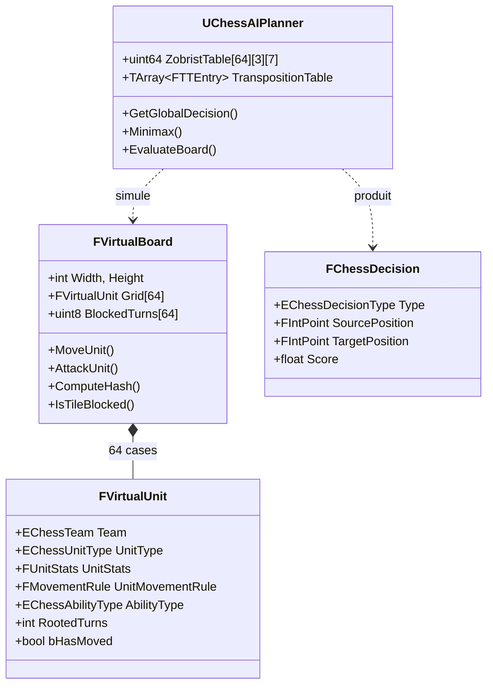
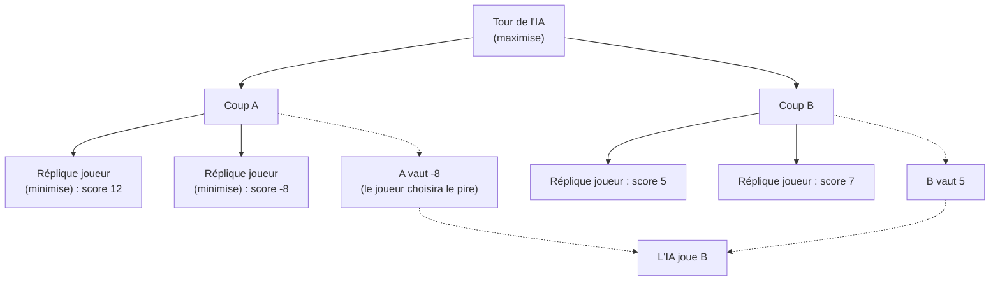
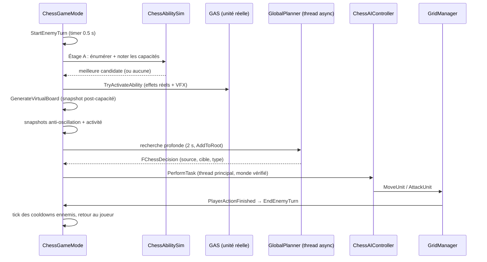

# L'intelligence artificielle de TRPG_Exam

*Documentation technique complète — s'adresse à un lecteur qui n'a jamais lu le code et ne connaît pas les algorithmes d'IA de jeu.*

---

## 1. Introduction

TRPG_Exam est un jeu tactique au tour par tour sur un plateau de type échecs (6×6 par défaut), où chaque pièce possède des points de vie, des dégâts et une capacité spéciale. Le joueur affronte une armée contrôlée par l'ordinateur. Ce document explique comment cette armée « réfléchit » : comment elle choisit ses coups, comment elle décide d'utiliser une capacité, pourquoi elle est rapide, et comment on règle son comportement.

L'IA repose sur un algorithme classique des jeux d'échecs, le **Minimax avec élagage alpha-beta**, enrichi de plusieurs techniques d'optimisation (table de transposition, hachage de Zobrist, approfondissement itératif) et d'une couche de décision dédiée aux capacités spéciales.

### Les fichiers concernés

| Fichier | Rôle |
|---|---|
| `AI/ChessAIPlanner.h/.cpp` | Le cerveau : structures du plateau virtuel, recherche Minimax, évaluation |
| `AI/ChessMovementLogic.h/.cpp` | Les règles de déplacement des pièces (partagées jeu réel / IA) |
| `AI/ChessAbilitySim.h/.cpp` | Miroirs simulables des capacités spéciales |
| `AI/ChessAIController.cpp` | L'exécuteur : traduit une décision en action réelle |
| `Framework/ChessGameMode.cpp` | L'orchestrateur du tour ennemi (phases, threading) |
| `Managers/ChessGridManager.cpp` | Le plateau réel, et le pont réel → virtuel (`MakeVirtualUnit`) |
| `Tools/ChessLevelDesigner.cpp` | Outil connexe : génération de niveaux par auto-jeu (self-play) |

---

## 2. Les fondations : le plateau virtuel

### 2.1 Pourquoi un plateau « virtuel » ?

Pour choisir un bon coup, l'IA doit imaginer des milliers de futurs possibles : « si je joue ceci, il répondra cela, alors je pourrai... ». Il est impensable de simuler ces futurs avec les vrais objets du jeu (acteurs Unreal, composants GAS, animations) : trop lourds, trop lents, et pleins d'effets de bord.

La solution est une **copie ultra-légère du plateau** : le `FVirtualBoard`. C'est un simple tableau de 64 cases contenant des `FVirtualUnit` — des structures de données pures (équipe, type, PV, dégâts, règle de déplacement, statuts). Copier un plateau virtuel coûte quelques microsecondes ; on peut donc en copier des centaines de milliers pendant une recherche.

### 2.2 Le snapshot : GAS reste la source de vérité

Dans le jeu réel, les PV et les dégâts vivent dans le **Gameplay Ability System** (GAS) d'Unreal : les attributs `Health`, `MaxHealth`, `Damage` sont modifiés par des GameplayEffects (passifs du skill tree, buffs, débuffs, dégâts). Le plateau virtuel n'est qu'une **photographie** de cet état, prise à des moments précis par `AChessGridManager::MakeVirtualUnit()` :

- PV et dégâts **réels** lus sur les attributs GAS (et non les valeurs de base) ;
- statut *Rooted* (immobilisé) lu en comptant les stacks de l'effet porteur du tag `Ability.Rooted` ;
- type de capacité équipée, résolu depuis l'ability GAS grantée ;
- drapeau `bHasMoved` (utile à la capacité First Charge).

Ce snapshot est régénéré à chaque fin de tour (`GenerateVirtualBoard`), ainsi qu'après chaque action qui modifie le plateau. Règle d'or du projet : **le gameplay réel passe par GAS, la simulation passe par le miroir** — et le miroir n'est jamais modifié à la main sans que GAS l'ait été d'abord.

### 2.3 Schéma des structures

### 2.4 La simulation du combat

Le combat virtuel (`FVirtualBoard::AttackUnit`) reproduit la règle du jeu réel : si les PV de la cible sont inférieurs ou égaux aux dégâts de l'attaquant, la cible meurt et **l'attaquant prend sa case** (capture façon échecs) ; sinon la cible perd les PV et personne ne bouge. Les cases bloquées (chausse-trappes) sont infranchissables mais jamais attaquables — une case bloquée est toujours vide par construction.

---

## 3. La génération de coups

Avant de réfléchir, il faut savoir ce qui est *légal*. C'est le rôle de `ChessMovementLogic::CalculateLegalMoves`, une fonction **statique et pure** (aucun état, aucun objet Unreal) utilisée à l'identique par l'interface du joueur, par les cartes de menace et par la recherche IA. Cette unicité est capitale : l'IA joue exactement avec les règles que voit le joueur.

Trois styles de déplacement existent :

- **Pawn** : une case en avant *ou en arrière* (spécificité du jeu), attaques uniquement en diagonale avant. Avec la capacité *First Charge* équipée et si le pion n'a jamais bougé, un double-pas avant est ajouté.
- **Slide** (tour, fou, reine) : glisse le long de vecteurs directionnels jusqu'à rencontrer un obstacle — pièce alliée (stop), pièce ennemie (attaque puis stop), case bloquée (stop net, sans attaque possible), bord du plateau.
- **Jump** (cavalier, roi) : saute directement sur des cases précises, occupées ou non.

Deux statuts filtrent le résultat en aval (`GetValidMoves`) : une unité *Rooted* conserve ses attaques mais perd tous ses déplacements ; les cases bloquées sont exclues à la source.

---

## 4. Le cœur : la recherche Minimax

### 4.1 L'idée en une image

Imaginez que l'IA joue mentalement une partie contre elle-même. Elle liste tous ses coups possibles ; pour chacun, elle liste toutes les meilleures répliques du joueur ; pour chacune de ces répliques, ses propres contre-répliques ; et ainsi de suite. Cela forme un **arbre de jeu** dont chaque niveau (appelé *pli*) alterne entre les deux camps.

Au bout de l'arbre — soit parce qu'on a atteint la profondeur maximale, soit parce que la partie y est finie — on **note** la position obtenue avec une fonction d'évaluation (section 5) : un nombre positif si elle favorise l'ennemi (l'IA), négatif si elle favorise le joueur.

Puis on fait remonter ces notes : à chaque nœud où c'est à l'IA de jouer, elle choisit le coup au score **maximal** ; à chaque nœud où c'est au joueur, l'algorithme suppose qu'il choisira le coup au score **minimal** (le pire pour l'IA). D'où le nom *Minimax* : l'IA maximise en supposant que l'adversaire minimise. Le coup finalement joué est celui dont la branche promet le meilleur score *même si l'adversaire joue parfaitement*.

### 4.2 La racine : une recherche globale unique

Le point d'entrée est `UChessAIPlanner::GetGlobalDecision`. À la racine, il génère les coups de **toutes** les pièces ennemies (et non d'une seule), puis lance la récursion `Minimax` sur chaque coup candidat. La décision produite (`FChessDecision`) contient la position source, la cible, le type (Move/Attack) et le score — le choix de « quelle pièce joue » est donc un sous-produit naturel de la recherche, pas une étape séparée.

Deux garde-fous existent à la racine : une **décision de repli** (le premier coup légal) est enregistrée immédiatement, pour que l'IA ait toujours quelque chose à jouer même si le temps de calcul est épuisé instantanément ; et si aucun coup n'existe, la décision `Null` déclenche le passage du tour.

### 4.3 L'approfondissement itératif et le budget temps

Plutôt que de chercher directement à une profondeur fixe, la recherche procède par **approfondissement itératif** : profondeur 1 complète, puis 2, puis 3... jusqu'à épuisement d'un **budget temps** (2 secondes). Cela peut sembler du gaspillage — on recommence tout à chaque profondeur — mais c'est en réalité très efficace, pour deux raisons : les profondeurs précédentes remplissent la table de transposition (section 6.3), ce qui accélère énormément les suivantes ; et l'algorithme devient *interruptible* : quand le temps expire, on garde le meilleur coup de la dernière profondeur complète. Sur un plateau de fin de partie, l'IA atteint couramment plus de 20 plis de profondeur et un million de nœuds explorés.

### 4.4 L'élagage alpha-beta

Le Minimax naïf explore tout l'arbre — une explosion exponentielle. L'**élagage alpha-beta** l'évite en maintenant deux bornes pendant la descente : *alpha* (le meilleur score que le camp maximisant peut déjà garantir) et *beta* (l'équivalent pour le minimisant). Dès qu'une branche ne peut mathématiquement plus influencer le choix final — parce que son score dépasse une borne — elle est **coupée** sans être explorée. Avec un bon ordre d'exploration (section 6.4), l'élagage permet d'atteindre environ le double de profondeur pour le même temps de calcul, sans changer le résultat : alpha-beta retourne exactement le même coup que le Minimax complet.

### 4.5 Fins de partie dans l'arbre

Deux situations terminales sont détectées en pleine recherche : un camp sans aucun coup légal (défaite dans les règles du jeu — *CantMove*) et la mort d'un roi (via l'évaluation). Ces situations reçoivent des scores gigantesques (±999 999 et ±1 000 000) qui écrasent toute autre considération. Subtilité : le score de victoire intègre la profondeur restante (`999999 + Depth`), de sorte qu'une **victoire rapide vaut plus qu'une victoire lente** — sans cela, l'IA qui voit deux chemins gagnants peut errer indéfiniment entre eux.

---

## 5. La fonction d'évaluation

Quand la recherche atteint une feuille de l'arbre, `EvaluateBoard` note la position. C'est la personnalité profonde de l'IA : tout ce qui n'est pas dans cette note n'existe pas pour elle. La note est la somme, sur toutes les pièces, de termes ajoutés pour les pièces ennemies et soustraits pour celles du joueur.

**Le matériel** — chaque pièce vaut `KillRpReward × 10 + PV_actuels × 2`. Les PV comptent : une pièce blessée vaut moins, donc infliger des dégâts améliore la note même sans tuer. Le roi est traité à part : `500 + PV × 50` — chaque PV du roi vaut 25 fois celui d'un pion, l'IA protège donc instinctivement sa santé.

**L'avancement des pions** — bonus progressif vers le camp adverse (plafonné à 10 % de la valeur de la pièce).

**Le contrôle du centre** — pour les autres pièces, bonus décroissant avec la distance au centre du plateau (formule adaptée à toute taille de plateau).

**La pression de développement** — une pièce non-royale encore sur ses rangées de départ subit un malus (−75 % du bonus max sur la deuxième rangée, −150 % sur la rangée du fond). C'est ce qui pousse l'IA à *sortir* ses tours et sa reine au lieu de les laisser dormir.

**La sécurité du roi** — chaque pièce adverse à distance ≤ 2 du roi pèse sur la note (12 points si adjacente, 6 à deux cases). Le roi apprend ainsi à s'écarter de la pression *avant* qu'une ligne de dégâts concrète n'apparaisse dans l'horizon de recherche — et symétriquement, l'IA valorise le harcèlement du roi adverse.

Ordres de grandeur à retenir : un pion vaut ~12 points, un PV de roi 50, une victoire 1 000 000. Les termes positionnels se comptent en unités — ils départagent, ils ne dominent jamais le matériel.

---

## 6. Les techniques d'optimisation

### 6.1 Zéro copie inutile

Le plateau virtuel pèse ~3 Ko. Les fonctions du chemin chaud (`GetValidMoves`, `CalculateLegalMoves`, `EvaluateBoard`, `Minimax`) le reçoivent par **référence constante** : la seule copie autorisée est celle, indispensable, du `SimBoard` sur lequel un coup est appliqué. Ce détail d'apparence anodine a multiplié le débit de la recherche.

### 6.2 Le hachage de Zobrist

Pendant la recherche, la même position peut être atteinte par des chemins différents (transpositions). Pour la reconnaître instantanément, chaque position est résumée en un nombre de 64 bits — son **hash de Zobrist**. Le principe : à l'initialisation, on tire un nombre aléatoire pour chaque combinaison (case, équipe, type de pièce) ; le hash d'une position est le XOR des nombres correspondant aux pièces présentes. Le hash intègre aussi tout l'état qui influence la légalité ou la valeur des coups : PV et dégâts courants, statut Rooted, drapeau `bHasMoved`, cases bloquées, et le camp au trait. Deux positions différentes sur *n'importe lequel* de ces aspects produisent des hashes différents — condition indispensable pour que la mémoire de l'IA ne mélange pas des situations distinctes.

### 6.3 La table de transposition

La **table de transposition** (TT) est la mémoire de la recherche : un grand tableau (~1 M d'entrées) indexé par `hash % taille`, où chaque entrée stocke le score d'une position déjà analysée, la profondeur de cette analyse, le meilleur coup qui y avait été trouvé, et le type de borne (score exact, borne inférieure ou supérieure — selon que l'analyse avait été coupée par alpha-beta). Quand la recherche retombe sur une position connue analysée au moins aussi profondément, elle réutilise le résultat au lieu de re-explorer tout le sous-arbre. La TT appartient au planner lui-même (elle a longtemps appartenu au GridManager — source de plantages et de courses de données, voir 6.6).

### 6.4 L'ordre des coups

L'efficacité d'alpha-beta dépend crucialement de l'*ordre* d'exploration : si le meilleur coup est essayé en premier, les autres branches sont coupées presque immédiatement. Trois priorités ordonnent les coups : le meilleur coup mémorisé dans la TT pour cette position (priorité 1000), puis les attaques (priorité 100), puis les coups calmes. À la racine, les attaques sont également triées en tête — ce qui sert aussi de départage : à score égal, l'IA préfère l'action.

### 6.5 Une recherche globale plutôt que N recherches parallèles

L'architecture historique lançait une recherche complète **par pièce ennemie**, en parallèle, puis comparait les résultats. C'était du travail dupliqué (chaque recherche re-explorait les mêmes répliques adverses), et les recherches parallèles écrivaient simultanément dans la TT partagée sans synchronisation — des scores corrompus pouvaient en résulter. La recherche globale unique (section 4.2) a remplacé tout cela : un seul thread, une seule TT, tout le budget temps au service d'une seule exploration plus profonde.

### 6.6 Threading et cycle de vie

La recherche tourne sur un **thread asynchrone** pour ne pas geler le jeu pendant 2 secondes. Trois protections encadrent ce thread : le planner est ancré contre le garbage collector (`AddToRoot`) pendant la recherche ; le retour au thread principal vérifie que le monde existe encore (`TWeakObjectPtr`) avant d'exécuter la décision — un rechargement de niveau pendant la réflexion ne crashe plus ; et `EndPlay` lève un drapeau `bAbortSearch` que la recherche consulte à chaque nœud. Corollaire de conception : **le code de recherche ne déréférence aucun objet Unreal extérieur** — tout ce dont il a besoin (tables, snapshots, drapeaux) lui appartient ou lui a été copié avant le lancement.

---

## 7. Le caractère : les ajustements à la racine

Trois mécanismes modifient le score des coups **uniquement à la racine** — jamais dans la récursion, pour ne pas polluer la TT ni fausser l'élagage (les bornes alpha-beta sont mises à jour avec les scores *bruts*).

**L'anti-oscillation** — un coup qui ramène une pièce sur sa case du tour précédent subit un malus de 1 point. Sans cela, l'IA peut osciller éternellement entre deux cases équivalentes. C'est un malus et non une interdiction : une vraie retraite tactique reste possible (les pions du jeu peuvent reculer).

**Le bonus d'activité** — chaque pièce mémorise depuis combien de tours elle n'a pas agi (`TurnsSinceLastAction`). Ce compteur, photographié avant chaque recherche, donne un bonus de `min(tours_inactifs, cap) × poids` au coup de la pièce concernée. Calibré pour rester sous la valeur d'un demi-pion, il ne départage que les coups quasi équivalents : l'IA répartit son activité sur toute son armée au lieu de ne jouer que sa plus grosse pièce, sans jamais sacrifier un avantage matériel pour « faire tourner l'effectif ».

**Le bruit** — un petit aléa (0 à ~0,5 point) est tiré une fois par coup racine et par décision. Son unique but : que deux parties rejouées à l'identique ne se déroulent pas exactement pareil. Son amplitude le rend invisible dès qu'un enjeu réel (matériel, mat) est en jeu.

---

## 8. Les capacités spéciales : une décision à deux étages

### 8.1 Le problème

Les capacités (Bastion, Répulsion, Chausse-trappe...) sont implémentées en GAS : des `UGameplayAbility` qui appliquent des GameplayEffects à de vrais acteurs. Impossible de les exécuter dans la simulation — et les intégrer comme coups ordinaires dans le Minimax ferait exploser l'arbre de recherche.

### 8.2 La solution : séparer le « si » du « quoi »

Le tour ennemi décide en deux étages indépendants, à l'image du joueur (pour qui les capacités sont des actions gratuites, le tour ne se terminant que par un déplacement ou une attaque) :

**Étage A — la capacité (rapide, sur le thread principal).** `TryUseEnemyAbility` énumère les candidates : pour chaque pièce ennemie vivante dont l'ASC ne porte pas le tag de cooldown, la capacité équipée (résolue depuis l'ability GAS grantée) et ses cibles possibles. Ces cibles, ainsi que l'effet de chaque capacité, sont fournis par `ChessAbilitySim` — une bibliothèque de **miroirs simplifiés** opérant sur le plateau virtuel (le soin devient un +PV, l'intimidation un −dégâts, la chausse-trappe un compteur de blocage...). Chaque activation candidate est appliquée sur une copie du plateau puis notée par une **mini-recherche peu profonde** (2 plis). Elle n'est retenue que si elle bat le score « sans capacité » d'une **marge minimale** — le prix d'un cooldown n'est payé que s'il rapporte vraiment. La meilleure candidate est alors exécutée **réellement, via GAS** (`TryActivateAbility`) : effets, cooldown et feedbacks visuels passent par le pipeline normal du jeu. Une seule capacité par tour, par choix de design.

**Étage B — le déplacement.** Le plateau virtuel est re-photographié (il inclut donc les effets de la capacité), et la recherche profonde de la section 4 choisit le coup du tour.

### 8.3 Les limites assumées

Le scoring à 2 plis ne voit pas les combos profonds (une capacité qui prépare un mat en trois coups). Les grandeurs des miroirs (`+2 PV`, `−1 dégât`...) sont codées en dur et doivent rester synchronisées avec les Blueprints GA_* correspondants. Enfin, les statuts simulés ne se décrémentent pas au fil des plis de la recherche profonde — une unité Rooted y est considérée immobile sur tout l'horizon, légère surestimation acceptée.

---

## 9. Le flux complet d'un tour ennemi

À la fin du tour de chaque camp, les effets à durée en tours (cooldowns, Rooted, Intimidated) perdent un stack ; les chausse-trappes se décomptent en fin de round complet.

---

## 10. Système connexe : le générateur de niveaux

L'outil `AChessLevelDesigner` réutilise toute la machinerie ci-dessus pour **concevoir les situations initiales** des 10 niveaux du jeu. Son principe : générer des placements aléatoires sous contraintes, les faire s'affronter en **auto-jeu** (le même Minimax joue les deux camps), mesurer l'intérêt de la partie obtenue, et ne garder que les meilleurs candidats.

Les contraintes de génération sont pilotées par des règles par niveau (`FLevelGenerationRule`) : types de pièces autorisés (introduction progressive au fil des niveaux), effectifs de chaque camp (croissants), taille du plateau (les premiers niveaux peuvent être plus petits), boss Empereur au niveau final, exactement un royal par camp, jamais d'Empereur côté joueur, et deux rangées de spawn par camp — le centre reste vide.

L'« intérêt » d'une partie est mesuré, faute de pouvoir mesurer le plaisir directement, par des proxys : la partie doit **se résoudre** (une partie sans vainqueur est éliminée d'office) ; les **bascules d'avantage** comptent (le signe de l'évaluation doit franchir un seuil d'hystérésis pour éviter de compter le bruit positionnel) ; les **échanges mutuels** comptent (les deux camps doivent perdre des pièces) ; la durée doit rester dans une fenêtre raisonnable ; et une victoire du joueur à jeu égal est bonifiée (niveau gagnable). Un criblage en deux passes (profondeur 2 pour éliminer, profondeur 5 pour départager les finalistes) et l'abandon des parties sans contact accélèrent le tri.

L'outil est déterministe (seeds explicites), pilotable par un Editor Utility Widget (progression, visualisation, régénération d'un seul niveau), et peut spawner un placement directement dans une map.

---

## 11. Table des réglages

| Réglage | Localisation | Défaut | Effet |
|---|---|---|---|
| `MaxSearchTime` | GetGlobalDecision | 2 s | Budget temps de la recherche profonde |
| `ActivityBonusWeight` / `Cap` | Planner | 0.75 / 4 | Force de la rotation d'effectif |
| `RootNoiseAmplitude` | Planner | 0.5 | Variété entre parties rejouées |
| `AbilityScoreMargin` | GameMode | 3.0 | Exigence avant de dépenser un cooldown |
| `AbilitySearchDepth` | GameMode | 2 | Profondeur du scoring des capacités |
| Pression de développement | EvaluateBoard | 0.75 / 1.5 × MaxBonus | Sortie des pièces des rangées de départ |
| Pression sur le roi | EvaluateBoard | 6.0 / palier | Prudence du roi, harcèlement du roi adverse |
| Malus anti-oscillation | GetGlobalDecision | 1.0 | Évite les allers-retours stériles |
| `KillRpReward` (DataTable) | DT_UnitsData | par pièce | Valeur matérielle relative des pièces |

Principe de calibrage : chaque ajustement comportemental doit rester **sous la valeur d'un pion (~12 points)** pour ne jamais l'emporter sur une considération matérielle.

---

## 12. Limites connues et évolutions possibles

- **L'Empereur n'est pas royal aux yeux de l'évaluation** : sa mort ne vaut pas un mat, l'IA ne le protège pas comme un roi. À traiter si le boss doit se comporter en boss.
- **Les statuts ne se décrémentent pas dans l'arbre** : Rooted/Intimidated sont considérés constants sur l'horizon de recherche.
- **Les grandeurs des miroirs de capacités sont dupliquées** entre `ChessAbilitySim` et les Blueprints GA_* — toute retouche d'équilibrage doit être reportée des deux côtés (une lecture automatique depuis les CDO est envisageable).
- **Les cooldowns ne survivent pas à une sauvegarde** : les GameplayEffects ne sont pas sérialisés dans la save — comportement actuellement accepté.
- **L'étage capacités est glouton** : une capacité n'est jamais choisie pour un bénéfice au-delà de 2 plis.
- **La TT n'est jamais vidée en cours de partie** : le hash enrichi rend les collisions inter-tours très improbables, mais pas impossibles.

---

*Document rédigé pour TRPG_Exam — état du code au moment de la rédaction. Les valeurs par défaut citées sont celles des propriétés exposées dans l'éditeur et peuvent avoir été retouchées depuis.*
