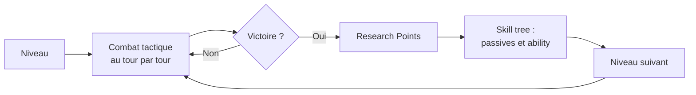
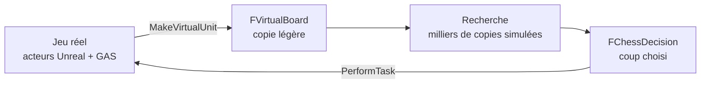
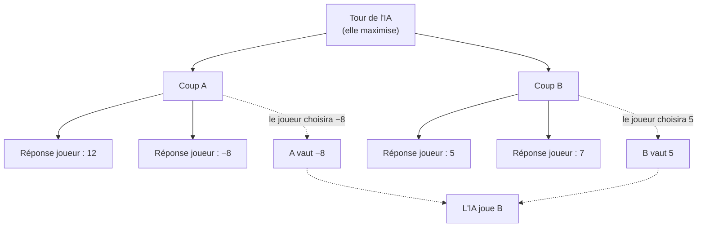
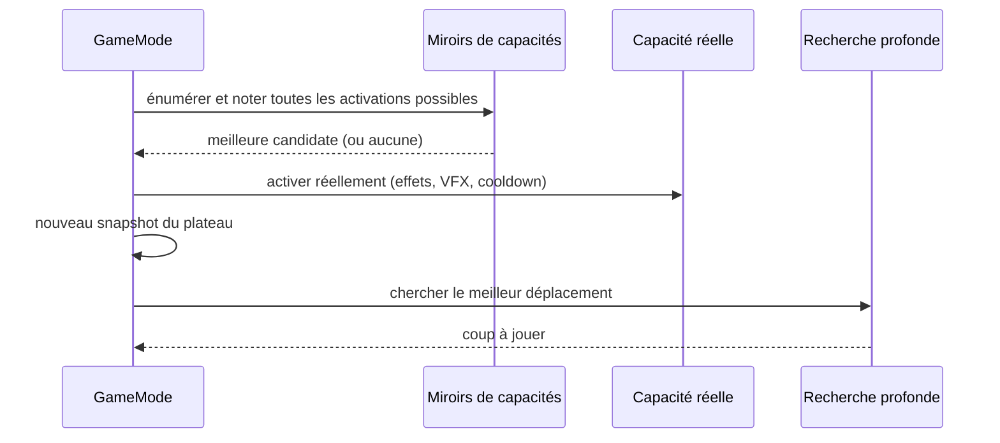
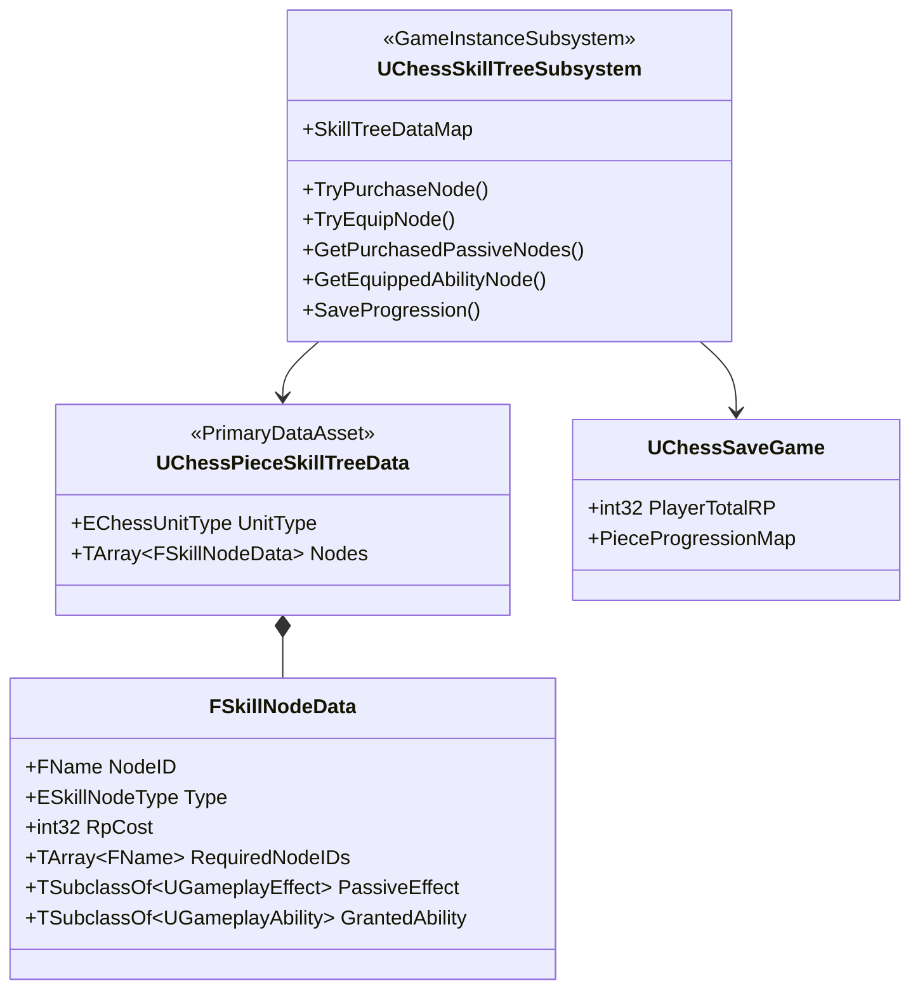
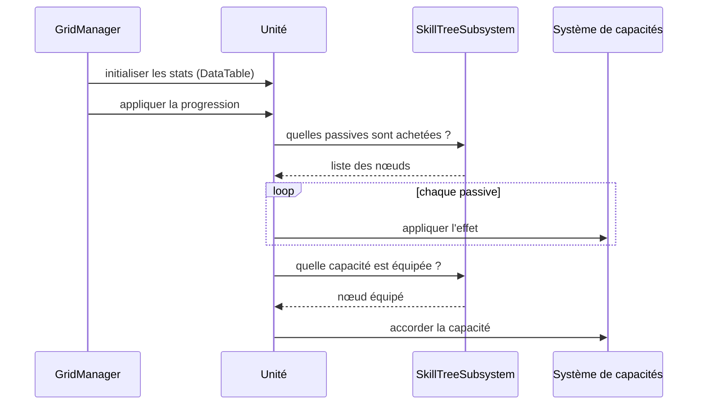
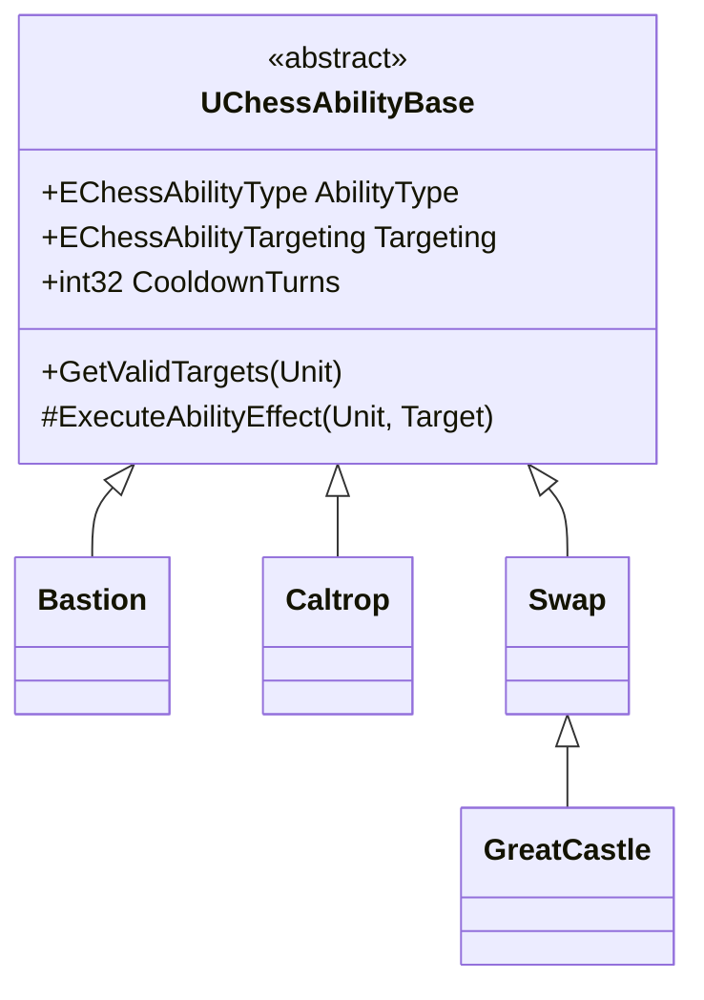
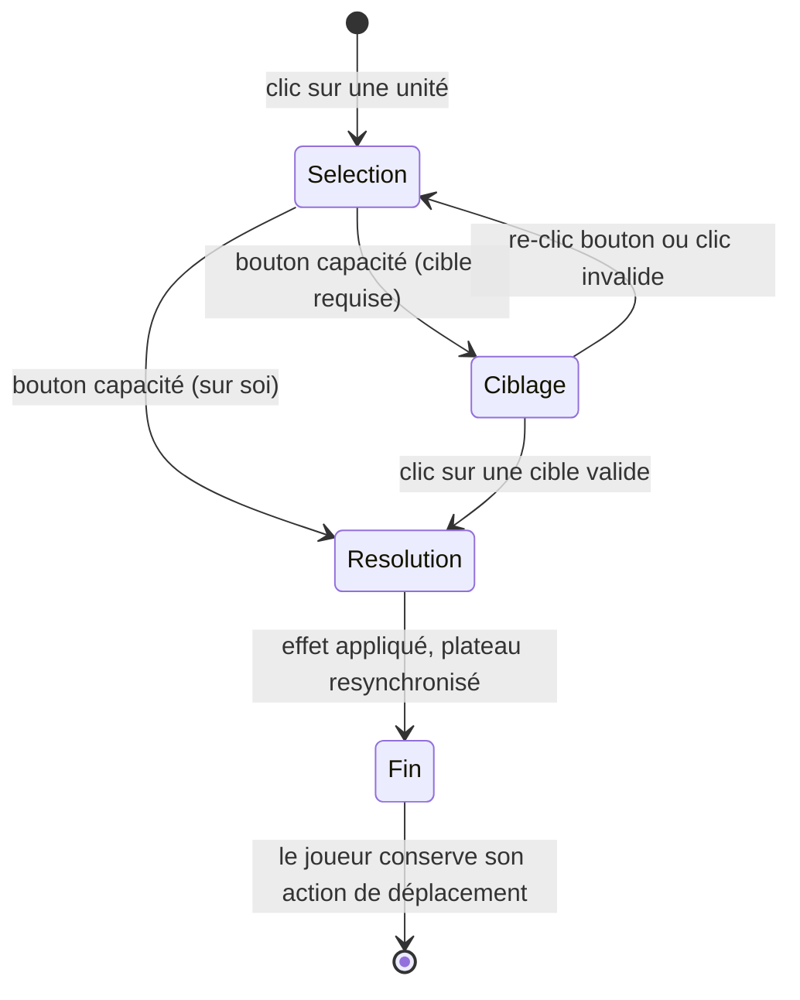
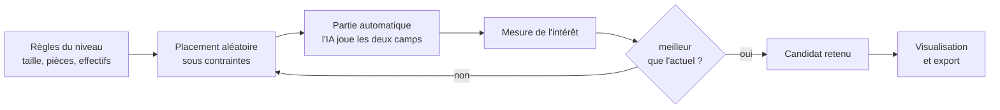
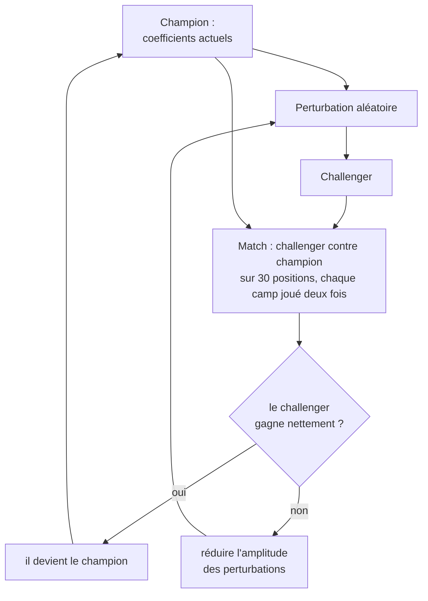

  

# TRPG_Exam

## Dossier de conception et de développement

 

**Un jeu de tactique au tour par tour**
**bâti sur la grammaire des échecs**

  

Moteur : Unreal Engine 5.6
Langages : C++ et Blueprint
Systèmes : Gameplay Ability System, intelligence artificielle de recherche,
outils de génération et d'optimisation

  

Auteur : Hugo Jobe

  

*Ce document s'adresse à un lecteur qui ne connaît ni le projet,*
*ni le fonctionnement des algorithmes de jeu, d'optimisation ou d'apprentissage automatique.*
*Chaque notion technique y est expliquée depuis le début.*

---

## Sommaire

1. [Introduction, intentions et inspirations](#1-introduction-intentions-et-inspirations)
2. [Les mécaniques et le modèle de jeu du joueur](#2-les-mécaniques-et-le-modèle-de-jeu-du-joueur)
3. [Développement — L'intelligence artificielle](#3-développement--lintelligence-artificielle)
4. [Développement — Le skill tree](#4-développement--le-skill-tree)
5. [Développement — Les abilities](#5-développement--les-abilities)
6. [Développement — Le Level Designer](#6-développement--le-level-designer)
7. [Développement — L'optimisation des weights](#7-développement--loptimisation-des-weights)
8. [Conclusion](#8-conclusion)

---

## 1. Introduction, intentions et inspirations

### 1.1 Ce qu'est le jeu

TRPG_Exam est un jeu de tactique au tour par tour qui se joue sur un plateau quadrillé, avec des pièces empruntées aux échecs — pion, cavalier, fou, tour, reine, roi — auxquelles s'ajoute un boss, l'Empereur. Le joueur affronte un adversaire contrôlé par l'ordinateur au fil de dix niveaux de difficulté croissante.

Trois différences majeures le séparent des échecs :

- **Les pièces ont des points de vie.** Une attaque ne capture plus systématiquement : elle inflige des dégâts. Un affrontement s'étale donc sur plusieurs tours.
- **Les pièces gagnent des capacités.** Entre les combats, le joueur dépense des *Research Points* dans un arbre de compétences propre à chaque type de pièce : bonus permanents ou capacités actives.
- **Le plateau est manipulable.** Certaines capacités bloquent des cases, érigent des murs temporaires ou repoussent des unités, faisant du terrain une ressource disputée.

### 1.2 Intentions de game design

**Utiliser une grammaire déjà connue.** Presque tout le monde sait comment se déplace un cavalier. Cette connaissance préalable est un capital : elle dispense d'un tutoriel sur les déplacements et, surtout, elle permet de créer de la surprise en contredisant les attentes. Quand le pion recule, quand la tour érige un mur, l'effet n'existe que parce que le joueur croyait savoir.

**Remplacer la capture par l'usure.** Aux échecs, chaque échange est binaire et définitif. En introduisant des points de vie, une même confrontation devient une négociation qui dure : on peut blesser, se replier, soigner, affaiblir. Cela ouvre la porte à des rôles (tank, glass cannon, soutien) et transforme la décision en gestion de ressources.

**Faire du plateau un acteur à part entière.** La moitié des capacités du jeu ne touchent aucune unité : elles ferment un passage, poussent, déplacent. L'objectif est que le joueur raisonne en termes de territoire et de mobilité, pas uniquement en termes de matériel.

**Faire de la progression un choix, pas une accumulation.** Le joueur ne peut équiper qu'**une seule** capacité active par type de pièce. Il construit donc une identité — un « deck » de six choix — au lieu d'empiler des pouvoirs.

### 1.3 Inspirations

| Source | Ce qui en est tiré |
|---|---|
| **Les échecs** | La grammaire de déplacement, la lecture instantanée du plateau, la pièce royale comme objectif |
| **Into the Breach** | L'information parfaite, le plateau réduit, la poussée et le blocage comme verbes centraux |
| **Tactics RPG** (Fire Emblem, Final Fantasy Tactics) | La progression entre les combats, les unités qui acquièrent des capacités |
| **Roguelites de progression** | Une monnaie de méta-progression dépensée dans un arbre, des niveaux successifs |

### 1.4 La boucle de jeu

Le combat produit la monnaie, la monnaie achète du pouvoir, le pouvoir permet d'aborder un combat plus difficile. Chaque niveau est conçu pour être gagnable à armes égales : la progression est un confort et un style de jeu, pas une obligation de grind.

---

## 2. Les mécaniques et le modèle de jeu du joueur

### 2.1 Ce qu'on appelle le « play model »

Le *play model* désigne le modèle mental que le joueur se construit : ce qu'il croit possible, ce qu'il anticipe, la manière dont il explique ce qui vient de se passer. Un jeu bien conçu ne se contente pas d'avoir des règles cohérentes : il gère activement la formation de ce modèle, en confirmant certaines attentes et en corrigeant les autres au bon moment.

Le jeu part de trois hypothèses que le joueur apporte avec lui.

**« Je sais comment cette pièce se déplace. »** — Vraie, et conservée telle quelle. Les règles de déplacement (`FMovementRule`) reprennent fidèlement les patterns d'échecs, déclinés en trois styles : `Slide` (glisse jusqu'à un obstacle : tour, fou, reine), `Jump` (atterrit sur des cases précises : cavalier, roi) et `Pawn` (avance, recule, attaque en diagonale). Aucune explication n'est nécessaire.

**« Toucher une pièce, c'est la capturer. »** — Fausse, et c'est le premier renversement du jeu. Les points de vie sont affichés en permanence au-dessus de chaque unité, et l'interface indique si une attaque sera fatale. Le joueur découvre en un tour que l'échange se planifie.

**« Le plateau est un décor fixe. »** — Fausse également. Les cases bloquées reçoivent un visuel persistant, volontairement distinct du surlignage de sélection, pour être perçues comme une propriété du terrain et non comme une aide d'interface.

### 2.2 Pourquoi chaque mécanique existe

| Mécanique | Problème résolu | Effet sur le modèle du joueur |
|---|---|---|
| **Points de vie** | L'échange binaire interdit toute nuance (soin, buff, repli) | Le joueur évalue un rapport de force, pas une capture |
| **Une action par tour** | Éviter la paralysie d'analyse, garder des tours lisibles | Chaque tour pose une question unique |
| **Capacités gratuites** (hors action) | Une capacité coûtant le tour ne serait jamais jouée | Le joueur cherche des combos capacité + déplacement |
| **Une seule capacité équipée par type** | Empêcher l'accumulation, forcer une identité | Le joueur construit un style, pas un inventaire |
| **Bonus passifs** | Progression chiffrée sans nouvelle règle à apprendre | Montée en puissance ressentie sans surcharge cognitive |
| **Contrôle de zone** | Donner un rôle aux pièces faibles | Le pion devient un outil de déni, pas une chair à canon |
| **Poussées** | Créer des menaces sans dégâts | La position devient une ressource attaquable |
| **Research Points** | Récompenser la manière de gagner | Le joueur prend des risques calculés |
| **Niveaux sans roi au début** | Enseigner les règles avant l'objectif | L'arrivée du roi devient un événement de design |

### 2.3 Le contrat d'information

Le jeu est à **information parfaite** : aucun hasard, aucun brouillard de guerre, aucun jet de dés. Points de vie, dégâts, temps de recharge et cases bloquées sont tous visibles, et l'IA ne dispose d'aucune information supplémentaire.

Ce choix est structurant à deux titres. Pour le joueur, il rend chaque défaite imputable à une décision, ce qui est la condition d'un sentiment de progression. Pour le concepteur, il impose que l'adversaire artificiel soit réellement fort, puisqu'il ne peut pas tricher : toute la difficulté du jeu repose alors sur la qualité de l'algorithme décrit au chapitre suivant.

La seule concession est un bruit minime introduit dans le choix final de l'IA, d'amplitude très inférieure à la moindre considération de matériel. Sa seule fonction est d'éviter que deux parties rejouées à l'identique se déroulent exactement de la même façon.

### 2.4 Comment la difficulté est dosée

Trois leviers indépendants, dont aucun ne consiste à avantager artificiellement l'ordinateur :

1. **La composition du niveau** — nombre et nature des pièces de chaque camp, avec une infériorité numérique croissante du joueur dans les derniers niveaux.
2. **La progression du joueur** — le skill tree compense cette infériorité, à condition d'investir judicieusement.
3. **Le temps de réflexion de l'IA** — plus il est élevé, plus elle anticipe loin. C'est un curseur de difficulté continu et honnête.

---

## 3. Développement — L'intelligence artificielle

C'est le système le plus important du projet : puisque l'IA ne triche pas, la qualité du jeu dépend directement de sa capacité à jouer correctement. Ce chapitre explique son fonctionnement en partant de zéro.

### 3.1 Le problème à résoudre

À chaque tour, l'ordinateur doit choisir une action parmi environ cinquante possibilités. Choisir « celle qui rapporte le plus tout de suite » ne fonctionne pas : capturer une pièce peut exposer la sienne au coup suivant. Il faut donc **anticiper**, c'est-à-dire explorer les conséquences de chaque coup, puis les réponses de l'adversaire, puis les réponses à ces réponses.

Cette exploration forme un **arbre de jeu** : à la racine la position actuelle, à chaque branche un coup possible, à chaque niveau (appelé *pli*) l'alternance des deux camps.

### 3.2 Le plateau virtuel

Explorer cet arbre suppose d'essayer des milliers de coups. Il est hors de question de le faire en déplaçant réellement les pièces à l'écran : les objets du moteur sont lourds, animés, et déclenchent des effets.

L'IA travaille donc sur une **copie allégée** du plateau, une simple structure de données appelée `FVirtualBoard` : un tableau de 64 cases contenant chacune, éventuellement, une `FVirtualUnit` (équipe, type, points de vie, dégâts, statuts). Copier ce plateau coûte quelques microsecondes, ce qui autorise des centaines de milliers de copies par seconde.

Cette copie est prise juste avant la réflexion, à partir de l'état réel du jeu — c'est ce qu'on appelle un *snapshot*. Le principe directeur est que **le jeu réel reste la source de vérité** ; la simulation n'en est qu'un reflet temporaire.

### 3.3 Le principe du Minimax

L'algorithme suppose deux joueurs aux intérêts strictement opposés. On attribue à chaque position un **score** : positif s'il favorise l'ordinateur, négatif s'il favorise le joueur humain.

L'ordinateur explore alors l'arbre en supposant que, à son tour, il choisira le coup au score **maximal**, et qu'à son tour l'adversaire choisira celui au score **minimal** — d'où le nom *Minimax*. Le coup finalement retenu est celui qui garantit le meilleur résultat **même si l'adversaire joue parfaitement**.

Le coup A semblait meilleur (il pouvait rapporter 12), mais il permettait une réplique dévastatrice. Le Minimax est donc une machine à éviter les pièges, pas une machine à espérer.

### 3.4 La fonction d'évaluation

Au bout de l'exploration, il faut bien attribuer un score à une position qui n'est pas terminée. C'est le rôle de la **fonction d'évaluation**, qui est la véritable personnalité de l'IA : tout ce qu'elle ne mesure pas n'existe pas pour l'ordinateur.

Elle additionne, pour chaque pièce, plusieurs termes :

| Terme | Ce qu'il mesure |
|---|---|
| **Matériel** | La valeur de la pièce, ses points de vie restants et ses dégâts |
| **Royauté** | Une valeur très élevée pour le roi, proportionnelle à ses points de vie |
| **Menace sur le roi** | Le nombre de pièces adverses couvrant réellement sa case |
| **Avancement des pions** | La progression vers le camp adverse |
| **Contrôle du centre** | La proximité au centre du plateau |
| **Développement** | Un malus pour les pièces encore sur leur rangée de départ |
| **Portée** | Le nombre total de cases atteignables par chaque camp (mobilité) |
| **Pièces pendantes** | Un malus pour les pièces attaquées et non défendues |

Un principe de calibrage gouverne l'ensemble : **aucun terme de comportement ne doit peser plus lourd qu'un pion**. Dans le cas contraire, l'IA sacrifierait du matériel pour satisfaire une préférence de style — défaut classique et immédiatement visible en jeu.

Un exemple concret du soin requis : la sécurité du roi est pondérée par le matériel qui lui reste. Un roi bien entouré doit fuir le danger ; un roi seul n'a plus rien à protéger et doit se battre. Sans cette pondération, les fins de parties dégénéraient en poursuites interminables.

### 3.5 Rendre la recherche possible : les optimisations

Explorer complètement l'arbre est impossible : avec cinquante coups par camp, dix plis représenteraient plus de dix millions de milliards de positions. Toute la difficulté consiste à en explorer le moins possible sans se tromper de coup.

**L'élagage alpha-beta.** C'est l'optimisation fondatrice. En mémorisant, pendant la descente, le meilleur résultat déjà garanti par chaque camp, on démontre parfois qu'une branche ne peut plus influencer la décision finale — on la coupe alors sans l'explorer. Le résultat est rigoureusement identique à celui du Minimax complet, pour environ la racine carrée du travail : à budget égal, on double la profondeur.

**L'ordre des coups.** L'efficacité de l'élagage dépend entièrement de l'ordre d'exploration : si le meilleur coup est essayé en premier, tout le reste est coupé immédiatement. Trois heuristiques classiques sont employées : essayer d'abord le coup mémorisé comme le meilleur dans cette position, puis les captures (en commençant par les proies les plus grosses), puis les *killer moves* — des coups calmes qui ont provoqué une coupure ailleurs dans l'arbre à la même profondeur — puis les coups ayant statistiquement bien réussi par le passé (*history heuristic*).

**La table de transposition.** Une même position peut être atteinte par des chemins différents. Pour la reconnaître, chaque position est résumée en une **empreinte numérique de 64 bits** (le *hachage de Zobrist*), calculée à partir de ce qui la caractérise : pièces, cases, points de vie, dégâts, statuts, cases bloquées et camp au trait. Cette empreinte sert de clé dans un grand tableau qui mémorise les positions déjà analysées. Retomber sur une position connue permet d'en réutiliser le résultat plutôt que de tout recalculer — c'est un cache, exactement comme on mémoriserait le résultat d'un calcul coûteux.

**L'approfondissement itératif.** Plutôt que de viser directement une profondeur fixe, l'IA cherche d'abord à un pli, puis deux, puis trois, jusqu'à épuisement de son budget de temps. Cela paraît redondant, mais chaque passe remplit la table de transposition et améliore l'ordre des coups de la suivante, ce qui rend l'ensemble plus rapide qu'une recherche directe. Surtout, la recherche devient **interruptible** : quand le temps est écoulé, on dispose toujours d'un coup complet et valide.

**La recherche de quiescence.** S'arrêter au milieu d'un échange conduit à des évaluations absurdes : l'IA « voit » qu'elle prend une pièce mais pas la reprise, juste au-delà de son horizon. Le remède consiste, à la frontière de la recherche, à ne plus jouer que les attaques jusqu'à ce que la position soit calme. Dans ce jeu où les combats s'étalent sur plusieurs tours à cause des points de vie, cette extension est déterminante.

**Les réductions de coups tardifs.** Puisque les coups sont triés du plus prometteur au moins prometteur, ceux situés en fin de liste sont probablement mauvais : on les explore à profondeur réduite, quitte à les reprendre à pleine profondeur s'ils se révèlent bons contre toute attente.

**Les structures de données.** Une optimisation moins spectaculaire mais décisive : le plateau virtuel a été rendu entièrement copiable en bloc, sans allocation mémoire. Les règles de déplacement, qui contenaient un tableau dynamique répliqué soixante-quatre fois par copie, ont été déplacées dans une table partagée. Et le module doit être compilé en configuration optimisée : passer d'une compilation de débogage à une compilation optimisée a multiplié la vitesse par un ordre de grandeur — l'optimisation la plus rentable du projet.

### 3.6 Résultat

Sur un plateau de six cases de côté avec une douzaine de pièces, l'IA explore environ trois millions de positions en une à deux secondes et anticipe **neuf plis**, soit plus de quatre tours complets pour chaque camp. Elle joue les échanges correctement, protège son roi selon la menace réelle, développe ses pièces et exploite le contrôle de zone.

### 3.7 Le cas particulier des capacités

Les capacités posent un problème spécifique : ce sont des objets du moteur agissant sur de vrais acteurs, impossibles à exécuter dans la simulation. Les intégrer comme des coups ordinaires ferait par ailleurs exploser la taille de l'arbre.

La solution retenue sépare la décision en deux étages. D'abord, une couche de **miroirs simplifiés** reproduit l'effet de chaque capacité sur le plateau virtuel (un soin devient un gain de points de vie, un piège devient une case bloquée). Chaque activation possible est évaluée par une recherche courte, et n'est retenue que si elle améliore la position d'une **marge significative** — le prix d'un temps de recharge ne se paie que s'il rapporte. La meilleure activation est alors jouée réellement, via le moteur de capacités. Ensuite seulement, la recherche profonde choisit le déplacement du tour, sur un plateau qui tient compte de la capacité utilisée.

### 3.8 Exécution technique

La recherche s'exécute sur un **thread séparé** afin de ne pas figer l'affichage pendant ses deux secondes de réflexion. Cela impose des précautions : la mémoire de recherche est protégée du ramasse-miettes, la validité du monde est revérifiée au retour (un rechargement de niveau pendant la réflexion ne doit pas provoquer de plantage), et un drapeau d'abandon permet d'interrompre proprement. La règle d'architecture qui découle de tout cela : **le code de recherche ne manipule aucun objet du moteur** — il ne travaille que sur des données qui lui appartiennent.

---

## 4. Développement — Le skill tree

### 4.1 Rôle dans le jeu

Le skill tree est le système de méta-progression : il transforme les *Research Points* gagnés en combat en pouvoir durable. Chaque type de pièce possède son propre arbre, ce qui signifie qu'améliorer ses pions n'améliore pas ses tours — le joueur doit répartir un budget limité entre six familles.

Deux natures de nœuds coexistent :

- Les **passives**, achetées définitivement, qui accordent un bonus permanent (points de vie, dégâts…).
- Les **equippable**, qui accordent une capacité active. Elles s'achètent également, mais une seule peut être **équipée** à la fois par type de pièce.

Cette distinction est le cœur du design de progression : les passives récompensent l'investissement cumulé, les equippable imposent un choix exclusif et donc une identité de jeu.

### 4.2 Architecture

Le système est **entièrement piloté par la data** : un arbre est un asset éditable, un nœud y déclare son coût, ses prérequis et l'effet ou la capacité qu'il accorde. La topologie de l'arbre n'est écrite nulle part explicitement — elle se déduit des prérequis déclarés par chaque nœud, ce qui permet d'ajouter une branche sans toucher au code.

L'état de progression n'est pas stocké non plus : il est **dérivé**. Un nœud est achetable si tous ses prérequis figurent dans la liste des nœuds déjà achetés et si le joueur dispose d'assez de points. Seules deux informations sont réellement sauvegardées : le total de points et, par type de pièce, la liste des achats et l'identifiant de la capacité équipée.

### 4.3 Application au combat

Au démarrage d'un niveau, chaque unité du joueur interroge le système de progression : elle applique un à un les effets de ses passives achetées, puis reçoit la capacité équipée. Les unités ennemies court-circuitent ce mécanisme et lisent directement des propriétés éditables pièce par pièce, ce qui permet au concepteur de composer des adversaires sur mesure.

L'ordre de ces deux étapes est critique : l'initialisation des statistiques écrase les attributs avec les valeurs de référence, elle doit donc impérativement précéder l'application des bonus. Un bug de cet ordre a d'ailleurs marqué le développement — les passives semblaient ne fonctionner qu'après un rechargement de niveau, symptôme d'une dépendance à l'ordre d'initialisation non garanti par le moteur.

---

## 5. Développement — Les abilities

### 5.1 Intention

Les capacités sont ce qui distingue le plus nettement le jeu des échecs. Chaque type de pièce en propose deux, mutuellement exclusives, réparties sur trois axes : **mobilité**, **contrôle du terrain** et **soutien ou puissance**.

| Pièce | Capacité | Effet |
|---|---|---|
| Pion | *First Charge* | Double pas lors du premier déplacement |
| Pion | *Caltrop* | Rend une case diagonale infranchissable |
| Fou | *Translation* | Saut latéral, change de couleur de diagonale |
| Fou | *Blessing* | Soigne un allié sur sa diagonale |
| Cavalier | *Intimidation* | Réduit les dégâts des ennemis adjacents |
| Cavalier | *Double Leap* | Saut de cavalier gratuit |
| Tour | *Great Castle* | Échange de position avec un allié aligné |
| Tour | *Bastion* | Érige un mur sur sa rangée, s'immobilise |
| Reine | *Execution* | Bonus de dégâts sur la prochaine attaque |
| Reine | *Repulsion* | Repousse toutes les unités adjacentes |
| Roi | *Escape* | Saut d'urgence, une seule fois par partie |
| Roi | *Swap* | Échange de place avec un allié adjacent |
| Empereur | *Summon* | Téléporte un allié à ses côtés |
| Empereur | *Punishment* | Dégâts de zone autour de lui |

### 5.2 Architecture technique

Les capacités reposent sur le **Gameplay Ability System** d'Unreal, un framework standard qui gère l'activation, les effets sur les attributs, les temps de recharge et les tags d'état. Une classe de base commune définit trois éléments : le type de ciblage (soi-même, une case, un allié, un ennemi), la liste des cibles valides et l'effet à appliquer.

Chaque capacité existe en deux couches : une classe C++ qui porte la logique, et un asset Blueprint qui porte les données (magnitudes, icônes, effets visuels). Le concepteur peut ainsi rééquilibrer sans recompiler.

La fonction listant les cibles valides sert simultanément à trois usages : surligner les cases sur le plateau, valider le clic du joueur, et griser le bouton quand aucune cible n'existe. Une seule source de vérité, donc aucune divergence possible entre ce qui est affiché et ce qui est autorisé.

### 5.3 Les temps de recharge en tours

Le framework du moteur ne connaît que des durées en secondes, ce qui n'a pas de sens dans un jeu au tour par tour. Le projet contourne cette limite par une astuce : un effet de durée infinie est appliqué avec un nombre de **cumuls** égal au nombre de tours, et un cumul est retiré à la fin du tour de chaque camp. Tant qu'il reste au moins un cumul, un tag d'état bloque l'activation.

Cette solution impose une règle de conception qui a coûté un bug notable : les effets porteurs de **modificateurs de statistiques** ne peuvent pas utiliser plusieurs cumuls, car le moteur additionne alors le modificateur autant de fois (un malus de un dégât appliqué en double devenait un malus de deux, rendant les dégâts négatifs). Les cumuls sont donc réservés aux effets purement porteurs de tags.

### 5.4 Le déroulement d'une activation

Un choix de design important structure tout ce système : **la capacité ne consomme pas l'action du tour**. Le joueur peut donc l'utiliser puis se déplacer ou attaquer, ce qui rend les combos naturels et fait des capacités un outil de préparation plutôt qu'une alternative coûteuse. L'IA, elle, est limitée à une capacité par tour, pour préserver la lisibilité de son comportement.

### 5.5 Retours visuels

Deux moments doivent être distingués pour le joueur : le lancement de la capacité, et son effet sur chaque unité touchée. Deux points d'accroche existent donc, l'un appelé une fois au lancement, l'autre appelé **une fois par unité affectée** — indispensable pour les effets de zone. Les états persistants (immobilisation, affaiblissement) sont signalés par un mécanisme d'écoute de tags : le visuel apparaît quand l'état est accordé et disparaît de lui-même à l'expiration, sans code de suivi.

Un délai est également introduit entre l'activation d'une capacité par l'IA et son déplacement, afin que le joueur ait le temps de lire ce qui vient de se produire.

---

## 6. Développement — Le Level Designer

### 6.1 Le problème

Concevoir dix situations de départ à la fois équilibrées, progressives et intéressantes est un travail difficile, qui demande normalement de jouer des dizaines de parties pour évaluer chaque disposition. L'idée de cet outil est de **retourner le moteur d'IA contre lui-même** : puisque l'ordinateur sait jouer, il peut jouer les deux camps et servir de banc d'essai.

### 6.2 Fonctionnement

Chaque niveau est décrit par une règle : dimensions du plateau, types de pièces autorisés, effectif de chaque camp, présence ou non d'une pièce royale, boss au dernier niveau. Le générateur produit des centaines de dispositions respectant ces contraintes, les fait jouer, et ne conserve que la meilleure.

Ces règles encodent la **courbe d'apprentissage** du jeu : les premiers niveaux se jouent sur un petit plateau, avec des pions seulement et **sans roi** — la victoire s'obtient par élimination. Le cavalier apparaît ensuite, puis le fou, puis le roi au niveau quatre, ce qui fait de la condition de victoire royale un événement de design plutôt qu'une règle imposée d'emblée. Les derniers niveaux introduisent l'infériorité numérique, puis le boss.

### 6.3 Mesurer l'intérêt d'une partie

Le plaisir n'étant pas mesurable directement, l'outil s'appuie sur des indicateurs indirects, choisis pour correspondre à ce qui rend une partie tactique intéressante :

| Indicateur | Effet sur la note | Justification |
|---|---|---|
| Partie sans vainqueur | éliminatoire | Une partie qui s'enlise n'est jamais bonne |
| Renversements d'avantage | fortement positif | C'est la définition mesurable de la tension |
| Pertes des deux camps | positif | Les deux camps doivent avoir saigné |
| Durée intermédiaire | positif | Ni massacre expéditif, ni interminable |
| Victoire du joueur | positif | Le niveau doit être gagnable à armes égales |

Cette phase a produit un enseignement méthodologique intéressant. Une première version notait très haut les parties comportant beaucoup de renversements d'avantage — et le générateur a « exploité » ce critère en produisant des positions où les pièces se déplaçaient sans jamais s'affronter, l'évaluation oscillant autour de zéro. Le critère mesurait donc du bruit et non de la tension. Il a fallu ajouter un seuil de significativité et exiger que la partie se termine. C'est une illustration classique du fait qu'un système d'optimisation trouve toujours la faille de la mesure qu'on lui donne.

### 6.4 Interface et usage réel

Un outil d'éditeur affiche les dix candidats en parallèle sous forme de grilles, avec leurs indicateurs, une barre de progression, et un bouton de régénération niveau par niveau permettant d'itérer sur une seule règle.

L'usage qui s'est imposé en pratique mérite d'être signalé : **les positions finales du jeu ont été conçues à la main**, l'outil servant à les *valider* plutôt qu'à les créer. La génération aléatoire produit rarement une intention de design — un verrou de pions, une menace asymétrique, une leçon tactique — mais elle mesure objectivement si cette intention produit une partie disputée. L'outil a donc changé de rôle en cours de développement, passant de générateur à banc de test.

---

## 7. Développement — L'optimisation des weights

### 7.1 Le problème

La fonction d'évaluation de l'IA repose sur une dizaine de coefficients : combien vaut un point de vie, quel poids donner au contrôle du centre, à quel point craindre une menace sur le roi… Ces valeurs ont été choisies à l'intuition. Rien ne garantit qu'elles soient bonnes, et rien ne permet de le vérifier autrement qu'en jouant.

L'objectif de ce module est de les **régler automatiquement**, par une méthode d'apprentissage.

### 7.2 De quel type d'apprentissage s'agit-il ?

Il ne s'agit pas de réseaux de neurones. La méthode employée relève de l'**optimisation boîte noire** : on ne sait pas calculer directement quels coefficients sont bons, mais on sait *tester* un jeu de coefficients en le faisant jouer. C'est la même famille d'algorithmes que celle utilisée pour régler les hyperparamètres d'un modèle d'apprentissage.

Le principe retenu, appelé **stratégie évolutionnaire (1+1)**, tient en quatre étapes répétées :

### 7.3 Comment juger qu'un réglage est meilleur

C'est le point le plus délicat du dispositif. On ne peut pas comparer les **scores d'évaluation** des deux jeux de coefficients : ce serait circulaire, chacun se déclarant vainqueur selon ses propres critères. Le seul juge valable est le **match direct**, avec quatre précautions :

1. **Chaque position est jouée deux fois, camps inversés.** Le jeu n'est pas symétrique ; sans cette alternance, on mesurerait l'avantage du camp et non la qualité des coefficients.
2. **Le budget de réflexion est compté en positions explorées, pas en secondes.** Une mesure en temps dépendrait de la charge de la machine.
3. **Le bruit de décision est désactivé**, faute de quoi deux parties identiques divergeraient sans rapport avec les coefficients testés.
4. **Les positions d'entraînement sont variées** — ouvertures, milieux de partie, finales, plateaux de tailles différentes — pour éviter que les coefficients ne s'adaptent à une seule situation.

Une amélioration importante consiste à noter chaque partie de façon **continue** plutôt que binaire : une victoire nette avec plusieurs pièces survivantes vaut mieux qu'une victoire arrachée. Cette nuance réduit fortement la dispersion des mesures, et donc le nombre de parties nécessaires.

### 7.4 La question de la significativité

Un piège guette ce genre de dispositif : croire un résultat qui n'est que du hasard. Sur vingt parties, un jeu de coefficients strictement équivalent peut très bien l'emporter à 55 % par simple fluctuation. Accepter tout résultat supérieur à 50 % reviendrait à accumuler du bruit, en croyant progresser.

Le protocole mesure donc sa propre dispersion — environ trois points de pourcentage dans la configuration retenue — et n'accepte un challenger qu'au-delà d'un seuil situé à environ 1,65 écart-type au-dessus de l'équilibre, ce qui correspond à une confiance d'environ 95 %.

### 7.5 Résultats

Un cycle de soixante itérations a produit cinq promotions. Les coefficients finaux s'écartent de moins de 14 % des valeurs choisies à la main :

| Coefficient | Manuel | Optimisé | Écart |
|---|---|---|---|
| Valeur du matériel | 10 | 10,36 | +3,6 % |
| Valeur d'un point de vie | 6 | 5,54 | −7,7 % |
| Échelle positionnelle | 3 | 2,59 | −13,8 % |
| Menace sur le roi | 25 | 22,3 | −10,8 % |
| Agressivité de l'Empereur | 5 | 4,32 | −13,5 % |

**Lecture honnête de ce résultat.** Les promotions ont été obtenues entre 54,8 % et 56,5 %, c'est-à-dire tout juste au-dessus du seuil de significativité. La tendance générale — un peu plus de matériel, un peu moins de positionnel — est cohérente, mais faiblement étayée. La conclusion défendable est que **les coefficients manuels se trouvaient déjà proches d'un optimum local**.

Ce résultat, apparemment décevant, est en réalité utile : il indique que le levier d'amélioration de l'IA ne se situe pas dans ces coefficients, mais dans ce que l'évaluation **ne mesure pas encore** (la notion de plan, de formation, de coordination à long terme). Il oriente donc les développements futurs.

### 7.6 Limites reconnues

- **Puissance statistique.** Détecter un gain réel de un point de pourcentage exigerait plusieurs centaines de parties par comparaison, contre soixante actuellement.
- **Caractère local de la recherche.** L'algorithme part des coefficients manuels et réduit progressivement son amplitude d'exploration : il ne peut pas découvrir un équilibre radicalement différent. Des redémarrages depuis des points aléatoires seraient nécessaires pour une exploration globale.
- **Perturbation multiplicative.** Un coefficient réglé à zéro ne peut jamais en sortir.
- **Alternatives plus efficaces.** Le *Texel tuning* — étiqueter des dizaines de milliers de positions par le résultat final de leur partie et ajuster les coefficients par descente de gradient — extrairait bien plus d'information de chaque partie. Un petit réseau de neurones remplaçant l'évaluation (approche NNUE des moteurs d'échecs modernes) serait techniquement réalisable, mais exigerait une quantification entière et des mises à jour incrémentales pour ne pas effondrer la profondeur de recherche : le rapport coût/bénéfice ne le justifiait pas ici.

---

## 8. Conclusion

### 8.1 Ce qui a été construit

TRPG_Exam associe un jeu tactique complet à trois systèmes techniques qui se répondent :

Un **adversaire artificiel** qui n'obtient aucun privilège : il voit exactement ce que voit le joueur, et sa force provient uniquement de la qualité de sa recherche. Sur un plateau de six cases de côté, il anticipe environ neuf demi-coups en explorant trois millions de positions par tour, grâce à un empilement d'optimisations classiques — élagage alpha-beta, table de transposition, tri des coups, quiescence — dont chacune a été mesurée avant d'être conservée.

Un **système de progression** entièrement piloté par la data, où l'ajout d'une capacité ou d'une branche d'arbre ne demande aucune ligne de code, et où le choix exclusif d'une capacité par type de pièce fait de la progression une affaire d'identité plutôt que d'accumulation.

Deux **outils de développement** qui utilisent le moteur de jeu comme instrument de mesure : un générateur de niveaux qui évalue des dispositions de départ en les faisant jouer automatiquement, et un optimiseur qui règle les coefficients de l'IA par confrontation directe.

### 8.2 Ce que le projet a appris

**Une IA de jeu est d'abord une fonction d'évaluation.** La recherche détermine la profondeur tactique, mais c'est l'évaluation qui définit le style. Tous les problèmes de comportement rencontrés — un roi trop craintif, des pièces qui fuyaient au lieu d'attaquer, des pions inutilisés — se sont révélés être des problèmes d'évaluation, jamais d'algorithme. Le plus instructif fut de découvrir que les dégâts d'une pièce n'entraient pas dans le calcul de sa valeur : l'IA ne pouvait donc littéralement pas comprendre l'intérêt d'un bonus de dégâts.

**Les optimisations doivent être mesurées, pas supposées.** Certaines interventions attendues comme décisives n'ont rien apporté, tandis que la plus rentable de toutes fut de compiler le module dans la bonne configuration. De même, deux techniques d'élagage apportaient un gain identique séparément, et aucun gain supplémentaire ensemble — ce qu'une mesure méthodique a révélé immédiatement.

**Un système d'optimisation trouve toujours la faille de sa métrique.** Le générateur de niveaux, récompensé sur les renversements d'avantage, a produit des parties où rien ne se passait. Ce phénomène, bien connu en apprentissage automatique, s'est manifesté ici de manière parfaitement concrète.

**Un résultat négatif est un résultat.** L'optimisation automatique des coefficients n'a pas produit de gain significatif. Plutôt que de survendre une amélioration à la limite du bruit statistique, la conclusion retenue est que les réglages manuels étaient déjà bons — ce qui a le mérite d'orienter les efforts futurs vers les bonnes questions.

### 8.3 Perspectives

Trois directions se dégagent naturellement.

Sur le plan du **jeu**, l'équilibrage des points de vie mérite d'être poursuivi : plusieurs pièces meurent encore en un coup, ce qui neutralise partiellement l'intérêt du système de dégâts progressifs.

Sur le plan de l'**IA**, le prochain palier consisterait à intégrer les capacités directement dans l'arbre de recherche. L'ordinateur pourrait alors construire de véritables combinaisons, et surtout **anticiper les capacités du joueur**, auxquelles il est aujourd'hui aveugle.

Sur le plan de l'**apprentissage automatique**, le *Texel tuning* représente le meilleur rapport entre effort et gain, et constituerait une suite naturelle au banc d'essai déjà en place.

 

*Document rédigé pour TRPG_Exam.*

