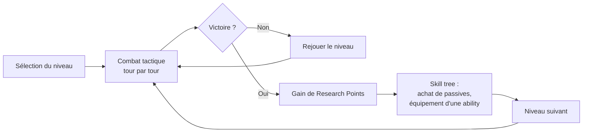
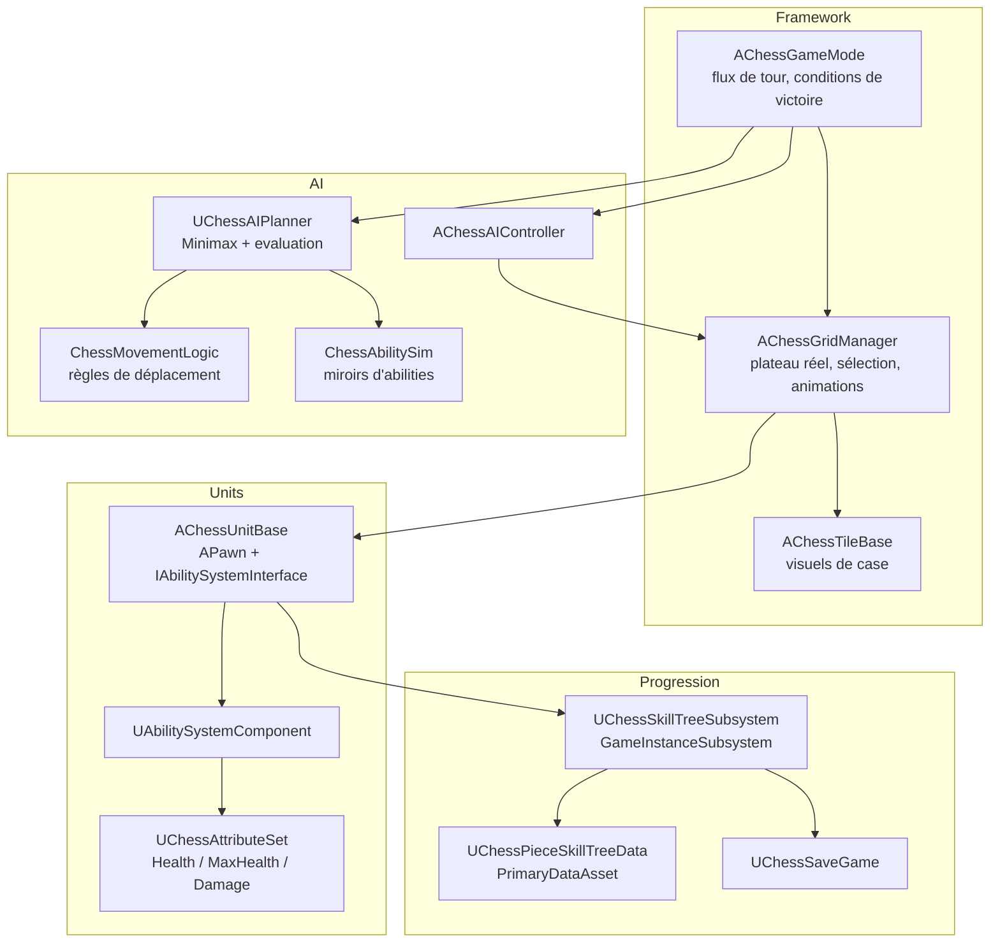
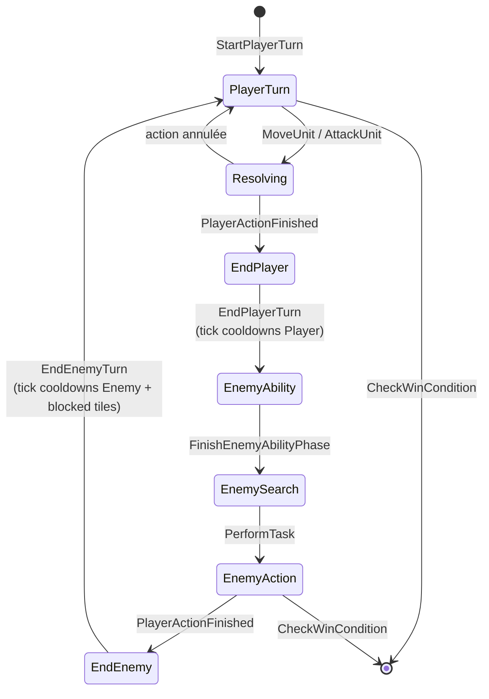
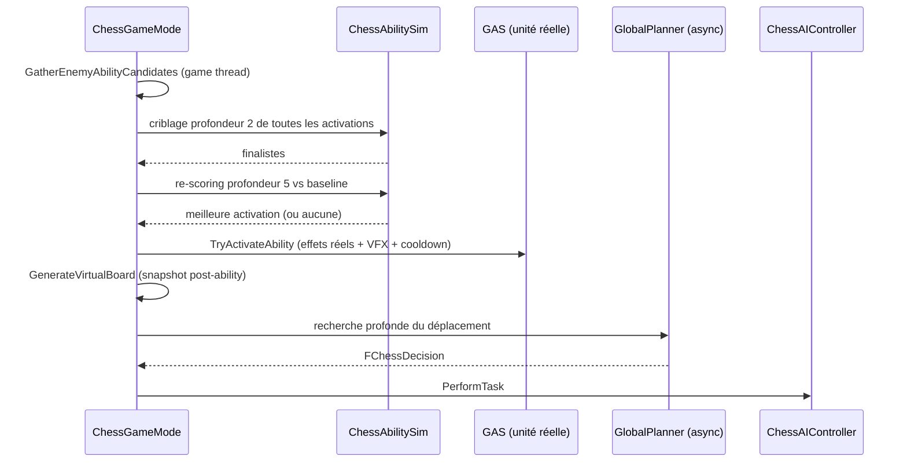
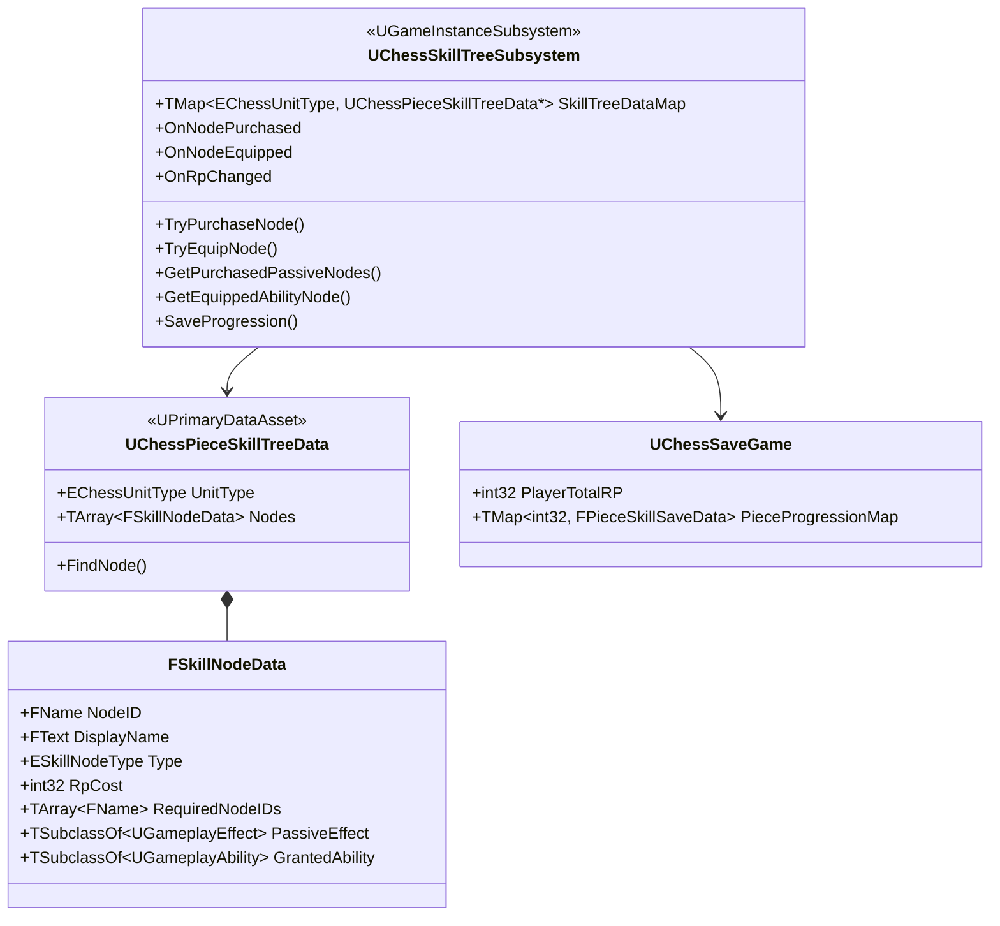
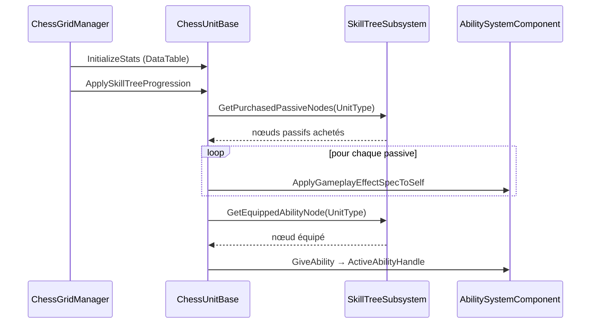
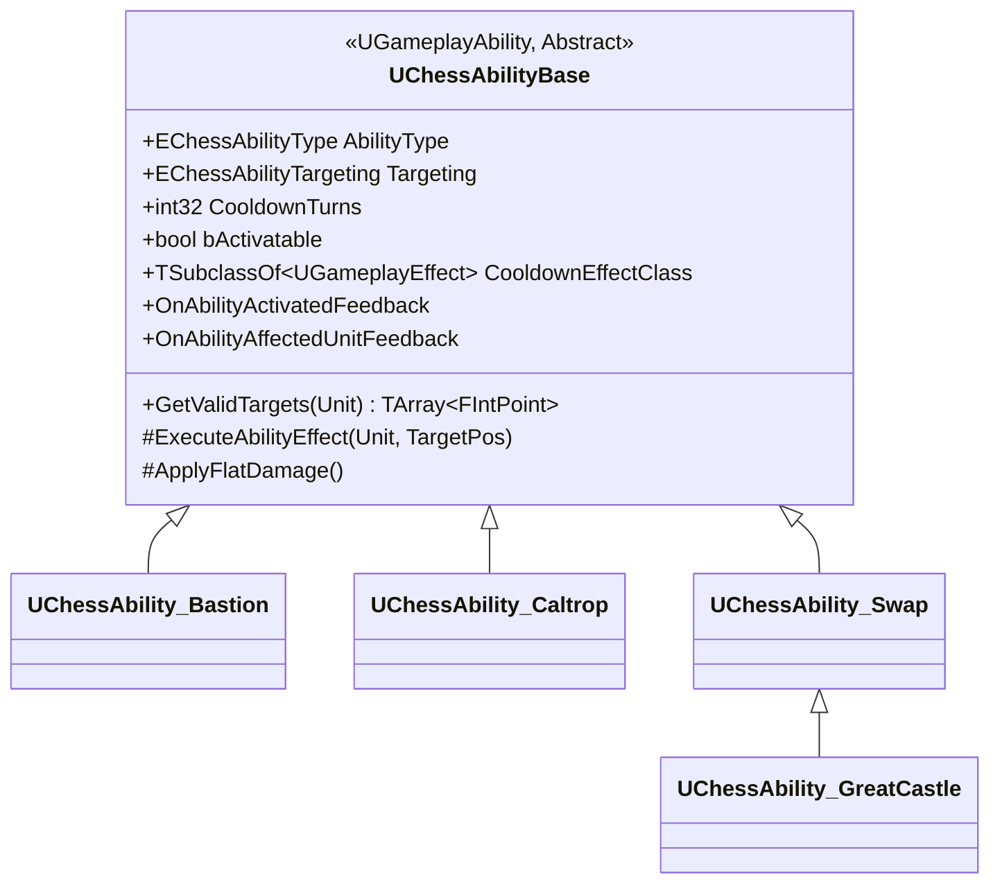
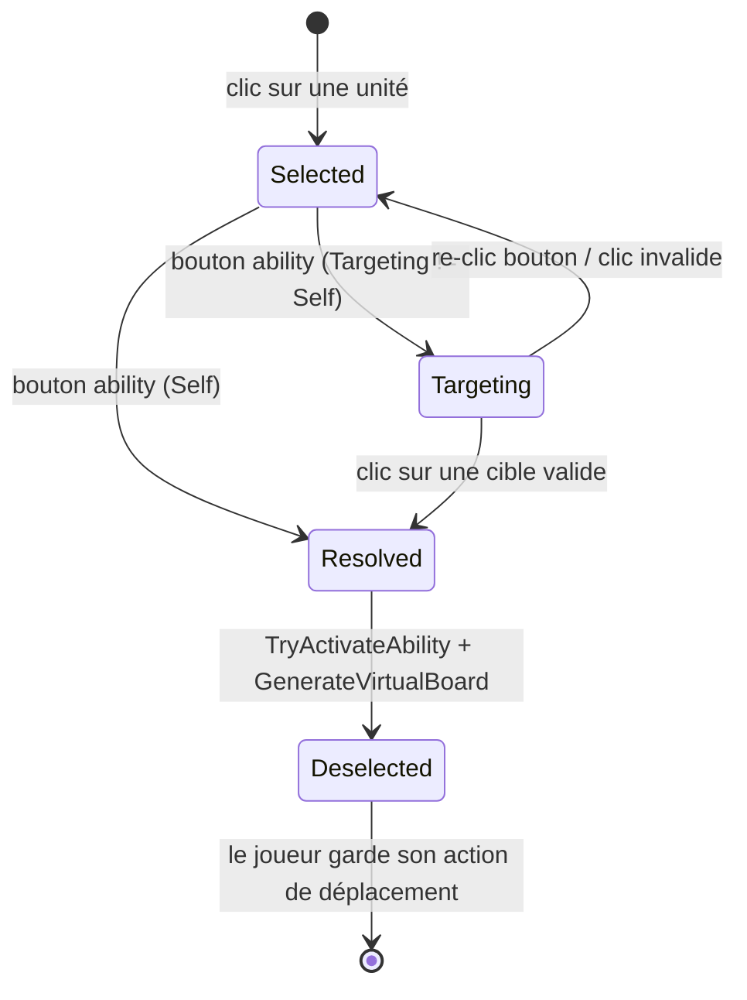
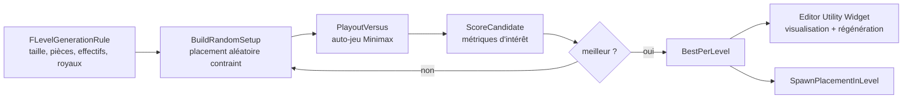
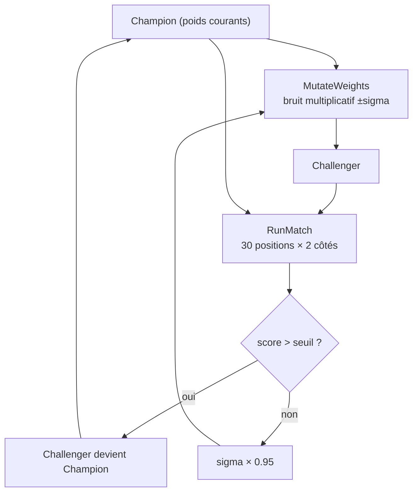

<div align="center">

# TRPG_Exam

## Document de conception et de développement

**Jeu de tactique au tour par tour sur plateau d'échecs augmenté**

Moteur : Unreal Engine 5.6 — C++ / Blueprint / Gameplay Ability System

Auteur : Hugo Jobe

</div>

---

<div style="page-break-after: always;"></div>

## Table des matières

1. [Introduction et intentions de game design](#1-introduction-et-intentions-de-game-design)
2. [Contrôles et interface](#2-contrôles-et-interface)
3. [Justification des mécaniques et play model du joueur](#3-justification-des-mécaniques-et-play-model-du-joueur)
4. [Scénarios de gameplay et reproduction](#4-scénarios-de-gameplay-et-reproduction)
5. [Développement technique](#5-développement-technique)
   - 5.1 [L'intelligence artificielle](#51-lintelligence-artificielle)
   - 5.2 [Le skill tree](#52-le-skill-tree)
   - 5.3 [Les abilities](#53-les-abilities)
   - 5.4 [Le Level Designer](#54-le-level-designer)
   - 5.5 [L'optimisation des weights](#55-loptimisation-des-weights)
6. [Annexes](#6-annexes)

---

<div style="page-break-after: always;"></div>

## 1. Introduction et intentions de game design

### 1.1 Le pitch

TRPG_Exam est un jeu de tactique au tour par tour qui prend les échecs comme **grammaire de départ** — un plateau, des pièces aux déplacements caractéristiques, un roi à protéger — puis en casse méthodiquement les certitudes : les pièces ont des points de vie, elles ne meurent donc pas en un coup ; elles gagnent des capacités actives et passives entre les combats ; et le plateau lui-même devient manipulable (murs temporaires, pièges, poussées).

Le joueur enchaîne dix niveaux de difficulté croissante contre une IA, et dépense entre chaque affrontement les *Research Points* gagnés au combat dans un arbre de compétences propre à chaque type de pièce.

### 1.2 Intentions de design

**Partir du connu pour surprendre.** Tout joueur reconnaît un cavalier et anticipe son saut. Cette familiarité est un capital : elle permet d'introduire immédiatement des règles qui la contredisent (le pion recule, la tour érige un mur, le fou se téléporte latéralement) et de produire un effet de surprise qui serait impossible avec des unités inventées de toutes pièces.

**Supprimer la mort instantanée pour créer de la durée.** Aux échecs, une pièce prise disparaît : chaque échange est binaire et définitif. En introduisant des points de vie, un affrontement s'étale sur plusieurs tours, ce qui ouvre la porte au soin, aux buffs, aux débuffs, au repli d'une unité blessée — et transforme la prise de décision en gestion de ressource plutôt qu'en calcul pur.

**Faire du plateau un acteur.** La moitié des capacités ne touchent aucune unité : elles bloquent une case, ferment une ligne, déplacent des pièces sans les attaquer. L'objectif est que le joueur pense en termes de *territoire* et pas seulement de matériel.

**Une progression qui change la façon de jouer, pas les chiffres.** Le skill tree distingue explicitement deux natures de nœuds : les *passives* (des GameplayEffects qui modifient les attributs) et les *equippable* (des capacités actives). Une seule capacité peut être équipée par type de pièce, ce qui force un choix identitaire plutôt qu'une accumulation.

### 1.3 Inspirations

| Source | Ce qui en est retenu |
|---|---|
| **Échecs** | La grammaire de déplacement, la lecture immédiate du plateau, la notion de pièce royale |
| **Into the Breach** | L'information parfaite, le plateau réduit, les poussées et le contrôle de zone comme verbes principaux |
| **Tactics RPG** (Final Fantasy Tactics, Fire Emblem) | La progression inter-combats, les unités qui gagnent des capacités, la mort qui coûte |
| **Roguelites de progression** | Les niveaux successifs, la monnaie de méta-progression (RP) dépensée dans un arbre |

### 1.4 Boucle de jeu



---

<div style="page-break-after: always;"></div>

## 2. Contrôles et interface

Le jeu se joue **entièrement à la souris**. Aucun binding clavier n'est nécessaire en jeu : l'interaction repose sur les événements de clic et de survol d'acteurs Unreal (`NotifyActorOnClicked`, `NotifyActorBeginCursorOver`), ce qui suppose `bEnableClickEvents` et `bEnableMouseOverEvents` activés sur le PlayerController.

### 2.1 Contrôles en combat

| Action | Entrée | Effet |
|---|---|---|
| Prévisualiser les déplacements | Survol d'une unité | Affiche les tiles accessibles et le HUD de l'unité |
| Sélectionner une unité | Clic gauche sur une unité alliée | Verrouille la sélection, affiche les déplacements et attaques |
| Se déplacer | Clic gauche sur une tile surlignée `Move` | Déplace l'unité, termine le tour |
| Attaquer | Clic gauche sur une unité ennemie surlignée `Attack` | Résout l'attaque, termine le tour |
| Désélectionner | Clic gauche sur l'unité sélectionnée ou sur une tile vide non surlignée | Annule la sélection |
| Activer une ability | Clic sur le bouton d'ability du HUD d'unité | Active immédiatement (ability `Self`) ou entre en mode ciblage |
| Choisir une cible d'ability | Clic gauche sur une tile ou une unité surlignée `AbilityTarget` | Résout l'ability |
| Annuler une ability | Nouveau clic sur le bouton d'ability, ou clic hors des cibles valides | Sort du mode ciblage, restaure l'affichage des déplacements |

### 2.2 Contrôles hors combat

| Action | Entrée |
|---|---|
| Naviguer dans le skill tree | Clic sur les nœuds (widget radial) |
| Acheter / équiper un nœud | Clic sur un nœud `Unlockable` ou `Purchased` |

### 2.3 Outils de debug

| Outil | Accès |
|---|---|
| Ajout de RP | Console : `AddRP <montant>` (via `UChessCheatManager`) |
| Rechargement de niveau | Touche de debug (Blueprint), bloquée pendant le tour ennemi |
| Affichage du virtual board | `bDisplayVirtualBoard` sur le GameMode |
| Affichage des threat / defense / balance maps | `bDisplayThreatMap`, etc. sur le GameMode |
| Statistiques de recherche IA | Message écran affiché en fin de tour ennemi (nœuds, profondeur) |

---

<div style="page-break-after: always;"></div>

## 3. Justification des mécaniques et play model du joueur

### 3.1 Le play model visé

Le joueur cible est supposé connaître les échecs sans être joueur d'échecs. Le jeu s'appuie donc sur trois hypothèses de modèle mental, et chaque mécanique existe pour en confirmer une ou la corriger volontairement.

**Hypothèse 1 — « je sais comment cette pièce se déplace ».** Vraie, et exploitée telle quelle : les `FMovementRule` reprennent les patterns d'échecs (`Slide`, `Jump`, `Pawn`). Aucune explication n'est nécessaire pour la majorité des unités.

**Hypothèse 2 — « toucher une pièce, c'est la tuer ».** Fausse, et c'est le premier renversement. Les points de vie sont affichés en permanence au-dessus des unités (`ToggleUnitHUD`), et la prévisualisation d'attaque indique si le coup est fatal. Le joueur apprend en un tour que l'échange se planifie sur plusieurs coups.

**Hypothèse 3 — « le plateau est un décor fixe ».** Fausse également : les cases bloquées (`Caltrop`, `Bastion`) reçoivent un visuel persistant distinct du highlight de sélection, précisément pour que le joueur intègre le terrain comme une variable.

### 3.2 Justification mécanique par mécanique

| Mécanique | Problème de design résolu | Conséquence sur le play model |
|---|---|---|
| **Points de vie** | L'échange binaire des échecs interdit toute nuance (soin, buff, retraite) | Le joueur évalue un rapport de force, pas une capture |
| **Une action par tour** | Éviter la paralysie d'analyse et garder des tours lisibles | Chaque tour est une question unique : « quelle pièce, pour quoi faire ? » |
| **Abilities gratuites** (hors action) | Une capacité qui coûterait le tour ne serait jamais jouée | Le joueur cherche activement des combos ability + déplacement |
| **Une seule ability équipée par type** | Empêcher l'accumulation et forcer une identité | Le joueur construit un « deck » de six choix qui définit son style |
| **Passives via GameplayEffects** | Progression chiffrée sans complexité de règles | Le joueur ressent une montée en puissance sans nouvelle règle à apprendre |
| **Contrôle de zone** (Caltrop, Bastion) | Donner un rôle aux pièces faibles | Le pion cesse d'être une unité de sacrifice et devient un outil de déni |
| **Poussées** (Repulsion) | Créer des menaces sans dégâts | Le positionnement devient une ressource attaquable |
| **Research Points** | Récompenser la performance, pas seulement la victoire | Le joueur prend des risques calculés pour maximiser ses gains |
| **Niveaux sans roi (1-3)** | Introduire les règles avant l'objectif | La condition de victoire royale devient un événement de design au niveau 4 |

### 3.3 Le contrat d'information

Le jeu est à **information parfaite** : pas d'aléatoire, pas de brouillard de guerre, pas de jets de dés. Les points de vie, les dégâts, les cooldowns et les cases bloquées sont tous visibles. Ce choix est structurant : il rend chaque défaite imputable à une décision du joueur et non à la malchance, et il permet à l'IA de partager exactement le même modèle d'information que le joueur — condition pour qu'elle soit perçue comme un adversaire honnête.

La seule source de non-déterminisme est un **bruit minime** appliqué au choix racine de l'IA (`RootNoiseAmplitude`), calibré sous le seuil de la moindre considération matérielle, dont l'unique fonction est d'éviter que deux parties rejouées à l'identique se déroulent exactement de la même manière.

### 3.4 Gestion de la difficulté

La difficulté est portée par trois leviers indépendants, ce qui permet de la doser sans jamais tricher :

1. **La composition des niveaux** — nombre et types de pièces (`FLevelGenerationRule`), avec un désavantage numérique croissant à partir du niveau 7.
2. **La progression du joueur** — le skill tree compense la montée en puissance ennemie, à condition d'investir intelligemment.
3. **Le budget de recherche de l'IA** — `MaxSearchTime` détermine sa profondeur d'analyse, et donc sa force réelle.

L'IA n'obtient jamais d'information cachée ni de bonus de statistiques : sa difficulté est uniquement fonction de son temps de réflexion et de la composition du niveau.

---

<div style="page-break-after: always;"></div>

## 4. Scénarios de gameplay et reproduction

Cette section décrit des situations de jeu caractéristiques et la manière de les reproduire, à des fins de test et de démonstration.

### 4.1 Scénario A — L'échange planifié

**Situation.** Une tour joueur (8 PV, 2 dégâts) affronte un cavalier ennemi (4 PV, 2 dégâts) à portée mutuelle.

**Déroulé attendu.** Le joueur attaque : le cavalier tombe à 2 PV, personne ne se déplace. L'IA doit alors choisir entre riposter (elle passe à 6 PV et sera tuée au tour suivant) ou se replier. Une IA correctement réglée se replie ou amène un soutien.

**Reproduction.** Niveau 5, ouvrir avec la tour vers le centre. Vérifier dans le log que la profondeur atteinte est ≥ 8 : en dessous, l'IA ne voit pas l'échange jusqu'au bout et riposte à tort.

### 4.2 Scénario B — Le mur de la tour

**Situation.** Le joueur équipe *Bastion* sur sa tour et l'active sur une rangée centrale.

**Déroulé attendu.** Toutes les cases libres de la rangée, à gauche et à droite jusqu'à la première pièce, deviennent infranchissables pendant deux rounds. La tour est immobilisée (`Ability.Rooted`) mais peut encore attaquer. L'IA doit contourner le mur : ses pièces glissantes s'arrêtent dessus, ses pions ne peuvent plus le traverser.

**Reproduction.** Niveau 5 ou plus, acheter et équiper `GA_Bastion` sur la tour. Vérifier que le visuel de blocage (`SetBlockedVisual`) survit à la désélection et disparaît bien à l'expiration.

### 4.3 Scénario C — Le déni par chausse-trappe

**Situation.** Un pion joueur pose une *Caltrop* sur la diagonale avant par laquelle une pièce ennemie devait passer.

**Déroulé attendu.** La case devient infranchissable deux rounds. L'IA recalcule et emprunte un autre chemin — visible dans son changement de trajectoire au tour suivant.

**Reproduction.** Niveau 1 à 3 avec `GA_Caltrop` équipé. C'est le scénario le plus simple pour vérifier que le miroir IA (`ChessAbilitySim`) et le hash Zobrist prennent bien en compte les cases bloquées.

### 4.4 Scénario D — La chasse de l'Empereur

**Situation.** Niveau 10. L'Empereur (18 PV, 4 dégâts, glissement de portée 2) avance vers la formation du joueur.

**Déroulé attendu.** L'IA le fait progresser (terme `EmperorAggression`), utilise *Summon* pour rapprocher un garde quand il est isolé, et *Punishment* dès que deux pièces du joueur sont adjacentes. Le joueur ne peut pas le tuer en un échange : il doit user ses PV en coordination, ou le bloquer avec des chausse-trappes.

**Reproduction.** Niveau 10, avancer volontairement deux pièces au contact pour déclencher *Punishment*.

### 4.5 Scénario E — La retraite du roi

**Situation.** Une pièce du joueur couvre la case du roi ennemi.

**Déroulé attendu.** Le roi se déplace ou se fait défendre dès que sa case est réellement couverte (`KingThreatWeight`). En revanche, s'il ne reste plus de matériel allié, l'échelle de sécurité tombe à zéro et le roi combat au lieu de fuir — les fins de partie restent décisives.

**Reproduction.** Sacrifier progressivement les pièces ennemies puis observer le changement de comportement du roi une fois isolé.

### 4.6 Scénario F — Le combo ability + déplacement

**Situation.** Le joueur active *Repulsion* avec sa reine, puis se déplace dans le même tour.

**Déroulé attendu.** Les unités adjacentes sont poussées d'une case (sauf blocage), ce qui ouvre une ligne d'attaque que la reine exploite immédiatement avec son action de déplacement. C'est le cœur du design « ability gratuite ».

**Reproduction.** Entourer volontairement la reine, activer *Repulsion*, constater les nouvelles cases accessibles après recalcul du highlight.

---

<div style="page-break-after: always;"></div>

## 5. Développement technique

### 5.0 Architecture générale



Le projet suit la séparation stricte `Public/` / `Private/` d'Unreal, avec des sous-dossiers miroirs : `AI/`, `Framework/`, `GAS/`, `Managers/`, `ResearchTree/`, `Tiles/`, `Units/`, `Tools/`, `FunctionLibs/`, `Cheats/`.

### 5.0.1 Flux de tour



Le point clé est le **funnel unique** : toute action, qu'elle vienne du joueur ou de l'IA, se termine par `PlayerActionFinished`, qui centralise la vérification de victoire et le passage de tour. Les effets à durée en tours (cooldowns, `Rooted`, `Intimidated`) perdent un stack à la **fin** du tour de leur camp ; les cases bloquées se décomptent en fin de round complet.

---

<div style="page-break-after: always;"></div>

### 5.1 L'intelligence artificielle

> Une documentation technique exhaustive du moteur de recherche existe séparément : `Docs/Documentation_IA.md`. Cette section en résume l'architecture et détaille les optimisations.

#### 5.1.1 Le plateau virtuel

Simuler des milliers de futurs avec de vrais acteurs Unreal serait impossible. L'IA travaille donc sur une copie légère : `FVirtualBoard`, un tableau de 64 `FVirtualUnit` contenant uniquement des types POD (équipe, type, stats, statuts). `AChessGridManager::MakeVirtualUnit` prend le **snapshot** depuis GAS — points de vie et dégâts réels lus sur les attributs, statut `Rooted` compté en stacks d'effets, ability équipée résolue depuis le spec granté.

Règle d'architecture : *le gameplay réel passe par GAS, la simulation par le miroir* — et le miroir n'est jamais modifié sans que GAS l'ait été d'abord.

#### 5.1.2 Minimax et élagage alpha-beta

L'IA construit un arbre de jeu où chaque niveau alterne les camps. Aux feuilles, une fonction d'évaluation note la position ; les scores remontent en maximisant côté ennemi, en minimisant côté joueur. L'**élagage alpha-beta** coupe les branches qui ne peuvent plus influencer le résultat, ce qui double approximativement la profondeur atteignable.

La recherche est **globale** : `GetGlobalDecision` génère à la racine les coups de *toutes* les pièces ennemies et retourne un `FChessDecision` (source, cible, type, score). Le choix de la pièce est donc un sous-produit de la recherche, et non une étape séparée — architecture qui a remplacé une version antérieure lançant une recherche par pièce en parallèle, coûteuse et sujette aux courses de données.

#### 5.1.3 Optimisations

| Technique | Principe | Gain mesuré |
|---|---|---|
| **Approfondissement itératif** | Profondeur 1, puis 2, puis 3… jusqu'à épuisement du budget temps | Recherche interruptible + alimentation de la TT |
| **Hachage de Zobrist** | Résumé 64 bits de la position, incluant PV, dégâts, statuts, cases bloquées et camp au trait | Base de la table de transposition |
| **Table de transposition** | Cache des positions déjà analysées (score, profondeur, borne, meilleur coup) | Évite de réexplorer les transpositions |
| **Ordre des coups** | TT > captures (MVV) > killer moves > history heuristic | +2 plis |
| **Late Move Reductions** | Les coups calmes tardifs sont explorés à profondeur réduite, re-explorés seulement s'ils surprennent | +1 pli, −15 % de nœuds |
| **Recherche de quiescence** | À la frontière, on ne joue plus que les attaques jusqu'au calme | Supprime l'effet d'horizon sur les échanges |
| **Structures POD** | Les `FMovementRule` (contenant un `TArray`) sortis de `FVirtualUnit` vers une table partagée par type | Copie de plateau sans allocation |
| **Build Development** | Compilation optimisée au lieu de DebugGame | Facteur 5 à 15 |

La dernière ligne mérite d'être soulignée : c'est l'optimisation la plus rentable de tout le projet, et la plus facile à manquer.

#### 5.1.4 La fonction d'évaluation

Elle constitue la personnalité de l'IA : ce qui n'y figure pas n'existe pas pour elle.

- **Matériel** : `KillRpReward × MaterialWeight + PV × HPWeight + Dégâts × DamageWeight`
- **Royaux** : `500 + PV × 50`, plus un terme de menace réelle basé sur la couverture de leur case, pondéré par le matériel allié restant (un roi isolé cesse de fuir et combat)
- **Positionnel** : avancement des pions, contrôle du centre, malus de développement sur les rangées de départ, bonus de chaîne de pions
- **Stratégique** : portée totale de chaque camp (mobilité), malus pour les pièces réellement non défendues
- **Empereur** : prime de proximité aux pièces adverses, aucune peur

Un principe de calibrage guide l'ensemble : **aucun terme comportemental ne doit dépasser la valeur d'un pion**, sous peine de faire primer le style sur le matériel.

#### 5.1.5 Les abilities dans la décision

Les abilities étant des `UGameplayAbility` agissant sur des acteurs réels, elles ne peuvent pas être exécutées dans la simulation. Le tour ennemi procède donc en deux étages :



Une activation n'est retenue que si elle bat le score « sans ability » d'une **marge minimale** — le prix d'un cooldown n'est payé que s'il rapporte. Une seule ability par tour est autorisée côté IA, par choix de design.

#### 5.1.6 Threading et robustesse

La recherche tourne sur un thread asynchrone pour ne pas geler le jeu. Trois protections l'encadrent : ancrage GC du planner (`AddToRoot`), vérification de la validité du monde au retour (`TWeakObjectPtr`), et drapeau `bAbortSearch` levé par `EndPlay`. Corollaire de conception : **le code de recherche ne déréférence aucun UObject extérieur** — tables, snapshots et drapeaux lui appartiennent ou lui ont été copiés avant lancement.

---

<div style="page-break-after: always;"></div>

### 5.2 Le skill tree

#### 5.2.1 Structure de données



Chaque type de pièce possède son propre `UChessPieceSkillTreeData`, un PrimaryDataAsset éditable listant ses nœuds. Un nœud est de type `Passive` (porteur d'un `UGameplayEffect`) ou `Equippable` (porteur d'un `UGameplayAbility`), et déclare ses prérequis par `RequiredNodeIDs` — ce qui définit implicitement la topologie de l'arbre.

#### 5.2.2 Progression et persistance

L'état est intégralement dérivé : un nœud est *achetable* si tous ses prérequis figurent dans `PurchasedNodeIDs` et si le joueur possède assez de RP. `UChessSkillTreeQuery` expose à l'UI un `ESkillNodeState` calculé à la demande (`Locked`, `Unlockable`, `Purchased`, `Equipped`), tandis que `UChessSkillTreeLayout::ComputeFullLayout` calcule les positions radiales des nœuds pour le widget.

La sauvegarde (`UChessSaveGame`, slot `"ChessSkillTree"`) est écrite à chaque achat et chargée à l'initialisation du subsystem. Elle stocke le total de RP et, par type de pièce, la liste des nœuds achetés et l'identifiant du nœud équipé.

#### 5.2.3 Application en combat



`RegisterStartingUnits` appelle `InitializeStats()` puis `ApplySkillTreeProgression()` dans cet ordre déterministe pour chaque unité du plateau — l'ordre importe, puisque `InitializeStats` écrase les attributs avec les valeurs de la DataTable et effacerait sinon les bonus passifs. Les unités ennemies court-circuitent le subsystem et lisent directement leurs propriétés `PassiveEffects` et `ActiveAbility`, éditables par pièce.

---

<div style="page-break-after: always;"></div>

### 5.3 Les abilities

#### 5.3.1 Architecture GAS



Chaque ability est une classe C++ dérivée de `UChessAbilityBase`, déclinée en Blueprint `GA_*` pour porter la data (magnitudes, icônes, VFX, référence au GE de cooldown). Deux virtuels structurent tout : `GetValidTargets` (utilisé à la fois pour le highlight, la validation du clic et le grisage du bouton) et `ExecuteAbilityEffect` (l'effet réel sur le plateau).

#### 5.3.2 Cooldowns en tours

GAS ne connaît que des durées en secondes. Le projet implémente donc les cooldowns par tours avec une astuce : un `GameplayEffect` de **durée infinie appliqué avec N stacks**, portant le tag `Ability.Cooldown`. Un stack est retiré à la fin du tour de chaque camp (`TickAbilityCooldowns`), et `ActivationBlockedTags` interdit l'activation tant que le tag est présent. Une valeur `CooldownTurns = -1` (99 stacks) donne un usage unique par partie.

Deux règles découlent de ce mécanisme :

- Les GE **porteurs de modificateurs d'attributs** ne doivent jamais utiliser plusieurs stacks : le stacking `AggregateByTarget` multiplierait le modificateur (un `-1 Damage` à 2 stacks deviendrait `-2`). Ils utilisent donc un stack unique.
- Les GE **purement porteurs de tags** (`Ability.Cooldown`, `Ability.Rooted`) utilisent les stacks comme compteur de tours.

#### 5.3.3 Le funnel d'activation



Le `AChessGridManager` porte l'état de ciblage (`bAbilityTargetingMode`) et expose à l'UI un point d'entrée unique, `OnAbilityButtonPressed`, qui active, entre en ciblage ou annule selon le contexte. La cible est déposée sur l'unité (`PendingAbilityTarget`) juste avant `TryActivateAbility`.

Choix de design important : **l'ability ne consomme pas l'action du tour**. Après résolution, l'unité est désélectionnée et le joueur conserve son déplacement ou son attaque.

#### 5.3.4 Catalogue

| Pièce | Ability | Type | Effet |
|---|---|---|---|
| Pion | *First Charge* | passif de movegen | Double pas au premier déplacement |
| Pion | *Caltrop* | tile | Rend une diagonale avant infranchissable 2 rounds |
| Fou | *Translation* | tile | Saut orthogonal adjacent (change de couleur de diagonale) |
| Fou | *Blessing* | allié | Soigne un allié blessé sur la diagonale |
| Cavalier | *Intimidation* | self | −1 dégât aux ennemis adjacents |
| Cavalier | *Double Leap* | tile | Saut de cavalier gratuit |
| Tour | *Great Castle* | allié | Échange de position sur ligne/colonne dégagée |
| Tour | *Bastion* | self | Mur infranchissable sur sa rangée, s'immobilise |
| Reine | *Execution* | self | +2 dégâts sur la prochaine attaque |
| Reine | *Repulsion* | self | Pousse toutes les unités adjacentes d'une case |
| Roi | *Escape* | tile | Saut dans un rayon de 2, une fois par partie |
| Roi | *Swap* | allié | Échange de position avec un allié adjacent |
| Empereur | *Summon* | allié | Téléporte un allié à ses côtés |
| Empereur | *Punishment* | self | Dégâts de zone aux ennemis adjacents |

#### 5.3.5 Feedbacks

Deux hooks Blueprint couvrent les deux temporalités : `OnAbilityActivatedFeedback` (une fois, au lancement, avec le type et le nom de l'ability) et `OnAbilityAffectedUnitFeedback` (une fois **par unité touchée**, indispensable pour les effets de zone). Les statuts persistants passent par `OnAbilityStatusChangedFeedback` sur l'unité, alimenté par `RegisterGameplayTagEvent` — un bouclier apparaît quand `Ability.Rooted` est granté et disparaît seul à l'expiration, sans code de suivi.

---

<div style="page-break-after: always;"></div>

### 5.4 Le Level Designer

#### 5.4.1 Intention

Concevoir dix situations initiales équilibrées et intéressantes est un travail de game designer expérimenté. L'outil `AChessLevelDesigner` répond à ce problème en **retournant le moteur d'IA contre lui-même** : il génère des placements aléatoires sous contraintes, les fait s'auto-jouer, mesure ce qui rend la partie intéressante, et ne conserve que les meilleurs candidats.



#### 5.4.2 Contraintes de génération

`FLevelGenerationRule` décrit chaque niveau : dimensions du plateau, types de pièces autorisés (introduction progressive), effectifs de chaque camp (croissants), présence d'une pièce royale, et boss au niveau final. Le générateur garantit structurellement : exactement une pièce royale par camp quand `bIncludeRoyal`, jamais d'Empereur côté joueur, et deux rangées de spawn par camp (une seule sur les petits plateaux) laissant le centre libre.

Un choix de design notable est encodé ici : **les niveaux 1 à 3 se jouent sans roi**. La victoire s'y obtient par élimination (`NoPiecesRemaining`), ce qui permet d'enseigner le déplacement, l'attaque et les points de vie avant d'introduire l'objectif royal comme un événement de design au niveau 4.

#### 5.4.3 Mesure de l'intérêt

Le plaisir n'étant pas mesurable directement, l'outil utilise des proxys :

| Critère | Poids | Justification |
|---|---|---|
| Partie non résolue | éliminatoire | Une partie sans vainqueur n'est jamais intéressante |
| Bascules d'avantage | +10 chacune | Mesure la tension ; seuil d'hystérésis pour ignorer le bruit positionnel |
| Échanges mutuels | +8 par pièce | Les deux camps doivent saigner |
| Durée dans la fenêtre 6-25 rounds | ±15 | Ni massacre, ni enlisement |
| Victoire du joueur | +20 | Le niveau doit être gagnable à jeu égal |

Deux optimisations rendent la génération utilisable : l'**abandon précoce** des parties sans capture après N rounds, et un **criblage en deux passes** (profondeur faible pour éliminer, profondeur élevée pour départager les finalistes).

#### 5.4.4 Interface

Un Editor Utility Widget affiche les dix candidats en parallèle sous forme de grilles ASCII colorées, avec leurs métriques, une barre de progression, et un bouton de **régénération par niveau** permettant d'itérer sur une seule règle sans relancer l'ensemble. Le mode bloquant `GenerateLevelsBlocking` produit en complément un dump ASCII dans le log, utile pour comparer hors interface.

**Usage réel dans le projet** : après expérimentation, les positions finales ont été conçues à la main, l'outil servant à les *valider* (auto-jeu, métriques) plutôt qu'à les créer. La génération aléatoire produit rarement l'intention de design qu'un humain formule — mais elle mesure objectivement si cette intention produit une partie tendue.

---

<div style="page-break-after: always;"></div>

### 5.5 L'optimisation des weights

#### 5.5.1 Problème

La fonction d'évaluation de l'IA repose sur une dizaine de coefficients (poids du matériel, des PV, des dégâts, échelle positionnelle, portée, menace sur le roi…). Les régler à la main est un travail d'intuition, difficile à justifier et sujet aux biais. L'objectif de ce module est de les **optimiser automatiquement** par apprentissage — au sens de l'optimisation boîte noire, la famille d'algorithmes utilisée pour les hyperparamètres.

#### 5.5.2 Dispositif

Tous les coefficients sont regroupés dans un `USTRUCT FAIWeights`, membre du planner, sérialisable en JSON (`Saved/AIWeights.json`) et rechargé au `BeginPlay` — **aucune recompilation n'est nécessaire** pour changer le comportement de l'IA.



L'algorithme est une **stratégie évolutionnaire (1+1)** : on perturbe les poids courants, on fait affronter le challenger au champion, et on promeut le challenger s'il gagne significativement ; sinon on réduit l'amplitude de recherche. La mutation parcourt automatiquement les champs `float` de la structure par réflexion Unreal — ajouter un poids ne demande aucune maintenance.

#### 5.5.3 Protocole de mesure

Le juge est le **match direct**, jamais le score d'évaluation (qui serait circulaire : chaque jeu de poids se déclarerait vainqueur selon ses propres critères). Quatre précautions garantissent l'honnêteté de la mesure :

1. **Alternance des camps** sur chaque position : le jeu n'est pas symétrique, sans quoi on mesurerait l'avantage du camp.
2. **Budget en nœuds** plutôt qu'en temps : reproductible d'une machine à l'autre et indépendant de la charge CPU.
3. **Bruit racine désactivé** : deux parties identiques doivent l'être.
4. **Positions d'entraînement variées** (ouvertures, milieux de partie, finales, tailles multiples) pour éviter le surapprentissage.

Le score de partie est **continu** plutôt que binaire : une victoire nette avec plusieurs pièces survivantes compte davantage qu'une victoire arrachée. Cette réduction de variance divise par deux ou trois le nombre de parties nécessaires.

#### 5.5.4 Résultats et interprétation

Un run de 60 itérations sur 30 positions (60 parties par comparaison) a produit 5 promotions, avec des poids finaux s'écartant de moins de 14 % des valeurs manuelles :

| Paramètre | Manuel | Optimisé | Écart |
|---|---|---|---|
| MaterialWeight | 10 | 10,36 | +3,6 % |
| HPWeight | 6 | 5,54 | −7,7 % |
| PositionalScale | 3 | 2,59 | −13,8 % |
| KingThreatWeight | 25 | 22,3 | −10,8 % |
| EmperorAggression | 5 | 4,32 | −13,5 % |

**Lecture honnête du résultat** : l'écart-type mesuré du protocole étant d'environ 3 % à 20 parties, les promotions obtenues entre 54,8 % et 56,5 % sont à la limite de la significativité statistique. La tendance de fond — légèrement plus de matériel, moins de positionnel — est cohérente mais faiblement étayée. La conclusion défendable est que **les poids manuels étaient déjà proches d'un optimum local**, ce qui constitue en soi un résultat : le levier d'amélioration de l'IA ne réside pas dans ces coefficients, mais dans ce que l'évaluation ne mesure pas encore.

Le dispositif conserve toute sa valeur méthodologique : il fournit un banc de test reproductible pour valider toute modification future de l'évaluation, et il documente quantitativement la sensibilité du jeu à chaque paramètre.

#### 5.5.5 Limites et pistes

- **Puissance statistique** : détecter un gain réel de 1 % exigerait plusieurs centaines de parties par comparaison. Une double confirmation des challengers acceptés (rejouer le match avant promotion) diviserait le taux de faux positifs pour un coût marginal.
- **Mutation multiplicative** : un paramètre à zéro ne peut jamais en sortir. Une mutation additive serait nécessaire pour explorer l'activation d'un terme désactivé.
- **Texel tuning** : étiqueter des dizaines de milliers de positions par le résultat final de leur partie, puis ajuster les poids par descente de gradient, serait bien plus efficace en données — chaque partie fournissant des centaines d'échantillons au lieu d'un seul.
- **Réseau de neurones (NNUE)** : remplacer l'évaluation par un petit perceptron est techniquement réaliste, mais exige quantification entière et mises à jour incrémentales pour ne pas effondrer la profondeur de recherche. Le rapport coût/bénéfice ne le justifiait pas dans le cadre de ce projet.

---

<div style="page-break-after: always;"></div>

## 6. Annexes

### 6.1 Principaux paramètres de réglage

| Paramètre | Localisation | Rôle |
|---|---|---|
| `MaxSearchTime` | `UChessAIPlanner` | Budget de réflexion de l'IA (difficulté) |
| `MaxSearchNodes` | `UChessAIPlanner` | Budget déterministe, utilisé par le tuner |
| `bUseLMR` / `bUseNullMove` | `UChessAIPlanner` | Techniques d'élagage |
| `MaxQuiescenceDepth` | `UChessAIPlanner` | Profondeur d'extension des échanges |
| `FAIWeights` | `Saved/AIWeights.json` | Tous les coefficients d'évaluation |
| `AbilityScoreMargin` | `AChessGameMode` | Exigence avant de dépenser un cooldown |
| `AbilityScreeningDepth` / `AbilityFinalDepth` | `AChessGameMode` | Profondeurs des deux passes de décision d'ability |
| `LevelRules` | `AChessLevelDesigner` | Composition et taille de chaque niveau |
| `DT_UnitsData` | DataTable | PV, dégâts, RP et règles de déplacement par pièce |

### 6.2 Limites connues

- L'Empereur est traité comme royal par l'évaluation, mais la cohérence avec `CheckWinCondition` doit être vérifiée à chaque évolution des conditions de victoire.
- Les statuts (`Rooted`, `Intimidated`) ne se décrémentent pas au fil des plis simulés : la recherche les considère constants sur son horizon.
- Les magnitudes des abilities sont dupliquées entre les Blueprints `GA_*` et leurs miroirs `ChessAbilitySim` : tout rééquilibrage doit être répercuté des deux côtés.
- Les cooldowns en cours ne survivent pas à une sauvegarde : les GameplayEffects ne sont pas sérialisés.
- La décision d'ability de l'IA reste gloutonne : aucune combinaison au-delà de la profondeur de re-scoring n'est anticipée, et les abilities du joueur ne sont pas prévues par la recherche.

### 6.3 Organisation du code

```
Source/TRPG_Exam/
├── Public/ & Private/
│   ├── AI/              ChessAIPlanner, ChessMovementLogic, ChessAbilitySim, ChessAIController
│   ├── Framework/       ChessGameMode, ChessSaveGame
│   ├── GAS/             ChessAttributeSet, ChessAbilityBase, ChessGameplayTags, Abilities/
│   ├── Managers/        ChessGridManager
│   ├── ResearchTree/    ChessSkillTreeSubsystem, ChessPieceSkillTreeData
│   ├── Tiles/           ChessTileBase
│   ├── Units/           ChessUnitBase
│   ├── Tools/           ChessLevelDesigner
│   ├── FunctionLibs/    ChessSkillTreeQuery, ChessSkillTreeLayout
│   └── Cheats/          ChessCheatManager
└── Docs/
    ├── Game_Design_Document.md   (ce document)
    └── Documentation_IA.md        (documentation technique de l'IA)
```

---

<div align="center">

*Document rédigé pour TRPG_Exam — état du projet à la date de rédaction.*

</div>
